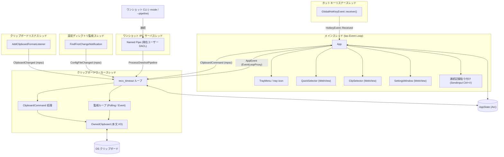

# ClipRefiner 開発者向けドキュメント

利用者向けの機能説明・操作方法は [README.md](README.md)、設定リファレンスは [CONFIG.md](CONFIG.md)、バージョンごとの変更内容は [CHANGELOG.md](CHANGELOG.md) を参照。本ドキュメントはビルド・テスト・リリース・ライブラリ利用 (`clip-refiner-core`) など開発者向け情報をまとめる。

## 目次

- [前提条件](#前提条件)
- [初回セットアップ](#初回セットアップ)
- [ソースからのビルド](#ソースからのビルド)
- [Windows パッケージ作成](#windows-パッケージ作成)
- [開発・テスト](#開発テスト)
  - [WebView E2E (Playwright)](#webview-e2e-playwright)
  - [テスト用ヘルパー (`test_helpers`)](#テスト用ヘルパー-test_helpers)
- [品質チェック](#品質チェック)
  - [Rust カバレッジ (`cargo-llvm-cov`)](#rust-カバレッジ-cargo-llvm-cov)
  - [Git フック](#git-フック)
  - [JavaScript リンター (ESLint / Prettier)](#javascript-リンター-eslint--prettier)
  - [サプライチェーン監査 (`cargo-deny`)](#サプライチェーン監査-cargo-deny)
- [ライブラリとしての利用](#ライブラリとしての利用)
- [プロジェクト構成](#プロジェクト構成)
- [スレッドモデル](#スレッドモデル)
- [ログ](#ログ)
- [環境変数](#環境変数)
- [リリースと変更履歴](#リリースと変更履歴)
- [Git 運用とコーディング規約](#git-運用とコーディング規約)
- [ドキュメント同期](#ドキュメント同期)

---

## 前提条件

開発・実行の対象 OS は **Windows** のみ。必要なツールは作業内容によって異なる。

| 用途 | 必要なもの |
| :--- | :--- |
| Rust のビルド・テスト | [Rustup](https://www.rust-lang.org/tools/install) (`rust-toolchain.toml` により Rust 1.96、rustfmt、Clippy を使用)、Visual Studio 2022 以降の **Desktop development with C++** ワークロード。ARM64 ネイティブまたはクロスコンパイルには **MSVC C++ ARM64/ARM64EC ビルドツール** と `rustup target add aarch64-pc-windows-msvc` も必要 (パッケージスクリプトが未導入なら追加する) |
| `scripts/windows/*.ps1` | [PowerShell 7](https://learn.microsoft.com/powershell/scripting/install/installing-powershell-on-windows) |
| UI の静的解析・JS ロジックテスト | [Node.js](https://nodejs.org/) と npm |
| WebView E2E | 対話可能なデスクトップセッション、[WebView2 Runtime](https://developer.microsoft.com/microsoft-edge/webview2/) |
| サプライチェーン監査 | [cargo-deny](https://github.com/EmbarkStudios/cargo-deny) |
| Rust カバレッジ | [cargo-llvm-cov](https://github.com/taiki-e/cargo-llvm-cov) と `rustup component add llvm-tools-preview` (`coverage.ps1` / `check.ps1 -Coverage`) |
| MSI 作成 | `cargo-wix`、`cargo-about`、WiX Toolset v3.14.1 以上 |

`cargo build` だけなら Node.js・`cargo-deny`・MSI 用ツールは不要。`check.ps1` は Node.js、`cargo-deny`、WebView2 Runtime を含む品質チェック一式の前提を要求する (カバレッジは任意)。通常の `cargo test` は Node.js が無い場合に JS ロジックテストを `note:` 付きでスキップする。

---

## 初回セットアップ

```powershell
git clone <repository_url>
Set-Location clip-refiner

# Rust ツールチェーンは rust-toolchain.toml から自動選択
rustup show active-toolchain

# UI の lint・整形・E2E 用依存
npm ci

# check.ps1 のサプライチェーン監査用
cargo install cargo-deny --locked

# 任意: Rust カバレッジ計測 (coverage.ps1 / check.ps1 -Coverage)
rustup component add llvm-tools-preview
cargo install cargo-llvm-cov --locked
```

任意で Git フックを有効化すると、コミット時に整形、プッシュ時に品質チェック一式を実行できる。

```powershell
./scripts/windows/install-hooks.ps1
```

---

## ソースからのビルド

[初回セットアップ](#初回セットアップ) のあと、リポジトリルートで実行する。ビルドだけなら Node.js は不要。

```powershell
cargo build -p clip-refiner --release
```

PowerShell スクリプトでターゲットを明示する場合:

```powershell
./scripts/windows/build.ps1 -Release
./scripts/windows/build.ps1 -Release -Target arm64
./scripts/windows/build.ps1 -Release -Target All
```

ホスト向けバイナリは `target/release/ClipRefiner.exe` に生成される。`-Target arm64` / `-Target x64` を明示した場合は `target/{triple}/release/ClipRefiner.exe` になる。

x64 ホストから ARM64 をクロスコンパイルする場合は、Visual Studio に ARM64 C++ ビルドツールが入っていること。パッケージスクリプトは未導入なら `rustup target add aarch64-pc-windows-msvc` を実行し、OS ネイティブのホストアーキテクチャで `vcvarsall.bat` (例: x64 ホストなら `x64_arm64`) を呼んで MSVC 環境を読み込む。ARM64 Windows 上の x64 rustc (エミュレーション) でも、ホストは OS 側の ARM64 ツールを使う。

---

## Windows パッケージ作成

### Windows MSI

`cargo-wix` と WiX Toolset v3 を使って MSI を作成できる。第三者ライセンス文書の生成に `cargo-about` も必要。

```powershell
cargo install cargo-wix --locked
cargo install cargo-about --locked --features cli
winget install WiXToolset.WiXToolset

./scripts/windows/build-msi.ps1
./scripts/windows/build-msi.ps1 -Target arm64
./scripts/windows/build-msi.ps1 -Target All
```

出力先: `target/wix/clip-refiner-{version}-{target-triple}.msi` (per-user インストール、日本語 UI)。`-Target` を省略するとホスト CPU (x64 または ARM64) 向け。`All` で両方を作成する。

`build-msi.ps1` は MSI 作成後に内容検証を自動実行する。既存 MSI のみ検証する場合:

```powershell
./scripts/windows/verify-msi.ps1
./scripts/windows/verify-msi.ps1 -Target arm64
./scripts/windows/verify-msi.ps1 -MsiPath target\wix\clip-refiner-{version}-{target-triple}.msi
```

**検証内容:**

| 区分 | 項目 |
| :--- | :--- |
| メタデータ | `Cargo.toml` の `upgrade-guid` と `wix/main.wxs` の `UpgradeCode` の一致 |
| MSI Property | `ProductName`, `ProductVersion`, `UpgradeCode`, `Manufacturer`, per-user (`ALLUSERS`) |
| MSI テーブル | 必須ファイル (`ClipRefiner.exe`, `LICENSE`, `THIRD_PARTY_NOTICES`)、Feature (`Binaries`, `Environment`, `Autostart`) |
| 展開内容 | 管理インストール (`msiexec /a`) で展開し、実行ファイルサイズ・`THIRD_PARTY_NOTICES` ヘッダー・生成物サイズ一致・PE アーキテクチャ (x64 / ARM64) を確認 |

`-SkipExtract` でデータベース検証のみに省略できる。`build-msi.ps1 -SkipVerify` でビルド後検証をスキップできる。

### ポータブル ZIP

インストール不要の配布物 (実行ファイル + `portable` マーカー) を作成できる。第三者ライセンス文書の生成に `cargo-about` が必要 (`-SkipNotices` で省略可)。

```powershell
cargo install cargo-about --locked --features cli

./scripts/windows/build-portable.ps1
./scripts/windows/build-portable.ps1 -Target arm64
./scripts/windows/build-portable.ps1 -Target All
```

出力先:

| 種類 | パス |
| :--- | :--- |
| 配布フォルダ | `target/portable/clip-refiner-{version}-{target-triple}-portable/` |
| ZIP | `target/portable/clip-refiner-{version}-{target-triple}-portable.zip` |

同梱内容: `ClipRefiner.exe` / `portable` / `LICENSE` / `THIRD_PARTY_NOTICES` / `PORTABLE.txt`

| オプション | 効果 |
| :--- | :--- |
| `-Target` | 配布 CPU。`Host` (既定) / `x64` / `arm64` / `All` / 完全な triple |
| `-SkipBuild` | 既存の `target/release/ClipRefiner.exe` (または `target/{triple}/release`) を使う |
| `-SkipZip` | フォルダのみ作成し ZIP を作らない |
| `-SkipNotices` | `THIRD_PARTY_NOTICES` を再生成しない (既存があれば同梱) |

ポータブルモードの挙動は [CONFIG.md のポータブルモード](CONFIG.md#ポータブルモード) を参照。

再実行時に既存配布フォルダ内の `ClipRefiner.exe` が起動中だと置き換えに失敗する。トレイから終了してから再実行すること。PowerShell 7 (`pwsh`) で実行すること (Windows PowerShell 5.1 では `#requires` により失敗する)。実行ファイルの探索は `$ProjectRoot\target` (または `CARGO_TARGET_DIR`) を使い、`cargo metadata` の JSON は日本語パス化け回避のため使わない。

---

## 開発・テスト

変更中は対象テストを絞り、完了前に品質チェック一式を実行する。

```powershell
# 短いフィードバックループ
cargo fmt
cargo test --test monitor_flow

# GUI セッションを使えない場合のチェック
$env:CLIP_REFINER_SKIP_E2E = '1'
./scripts/windows/check.ps1
Remove-Item Env:CLIP_REFINER_SKIP_E2E

# リリース前の全チェック (WebView E2E を含む)
./scripts/windows/check.ps1
```

```powershell
# 単体テスト・統合テストを実行 (デフォルト feature `app` で統合テストも含む)
cargo test

# 特定の統合テストのみ実行
cargo test --test monitor_flow
cargo test --test settings_flow

# UI 純粋ロジック (Node.js。未インストール時はスキップ)
cargo test --test settings_shared_logic
cargo test --test selector_logic

# core をテキスト変換のみ (feature なし) で検証
cargo test -p clip-refiner-core --no-default-features --all-targets

# ライブラリ API のドキュメントを生成
cargo doc -p clip-refiner-core --no-deps --open
```

UI の JavaScript (`crates/clip-refiner/src/ui/`) を変更したら `npm run build:ui` でバンドルを再生成し、`*.bundle.js` も同じコミットに含める。再生成を忘れると `cargo test` の `ui_bundle_flow` が失敗する ([JavaScript リンター](#javascript-リンター-eslint--prettier))。

統合テスト (`crates/clip-refiner/tests/`) では監視ループ・ワーカー・履歴・正規表現・連続記録・登録クリップの主要経路を検証する。`ClipboardHarness` が監視ループとワーカーコマンドを横断的に駆動する。

| ファイル | 検証内容 |
| :------- | :------- |
| `monitor_flow.rs` | 監視加工、Undo、一時停止、履歴上限、同一テキストの再加工抑制、自身の書き戻しスキップ、パイプライン、連続記録中の自動加工停止 |
| `worker_flow.rs` | 手動加工 (`ProcessMode`)、変更なし加工、Undo 空実行、履歴復元後の再加工抑制 (Polling / Event) |
| `worker_recovery_flow.rs` | クリップボードワーカーの起動、`restart` による復旧、復旧メニュー表示 |
| `history_flow.rs` | 暗号化履歴の記録・重複処理・復号 |
| `regex_flow.rs` | `config` の正規表現設定、コンパイルキャッシュ、Event 方式 |
| `ocr_flow.rs` | OCR 結果のクリップボード書き込みと再加工抑制 |
| `record_flow.rs` | 連続記録キュー (FIFO、貼り付け排出、履歴との独立性) |
| `clips_flow.rs` | 登録クリップの保存・コピーと再加工抑制 |
| `settings_flow.rs` | 設定ウィンドウ IPC のマージ・パッチ適用・監視/正規表現/連続記録/一時停止・`config.toml` 永続化往復 |
| `notification_flow.rs` | 通知設定の旧項目移行・IPC パッチ・トレイメニュー連携 |
| `platform_flow.rs` | ホットキー解釈・OS 登録・自動起動状態照会 |
| `update_flow.rs` | ローカル HTTP モック bridge による更新確認 → ダウンロード検証 → ポータブル ZIP 展開 / MSI 検証 (digest 欠落・ハッシュ / サイズ不一致・署名の欠落 / 信頼しない鍵 / 内容差し替え / 別バージョン向け署名 / 公開鍵なし・応答本文の宣言サイズ超過による途中打ち切り・API 404・キー必須 DL の成功 / 認証失敗含む。`msiexec` / 差し替えヘルパー / エクスプローラーは起動しない) |
| `regex_preview_logic.rs` | 設定 UI の正規表現プレビュー JS ロジック (Node.js 実行) |
| `settings_ui_logic.rs` | 設定 UI のパッチマージ JS ロジック (`settings_patch.js` / Node.js 実行) |
| `settings_shared_logic.rs` | 設定 UI 共有純粋ロジック (`shared_logic.js` / Node.js 実行) |
| `settings_panels_logic.rs` | 設定 UI パネル / イベント純粋ロジック (`panels_logic.js`: サイドバー HTML・WAI-ARIA タブ移動・クリップ行・パイプライン操作・クリック委譲 / Node.js 実行) |
| `selector_logic.rs` | セレクター共有・クイック・登録クリップ純粋ロジック (`selector-common.js` / `quick_selector_logic.js` / `clip_selector_logic.js` / Node.js 実行) |
| `ui_bundle_flow.rs` | コミット済み `*.bundle.js` 先頭の入力一覧・SHA-256 をソースから再計算し、バンドルの再生成忘れを検出 (Node.js 不要) |
| `oneshot_flow.rs` | ワンショット相当のパイプライン加工・常駐委譲時の監視エコー回避 |
| `oneshot_ipc_flow.rs` | 実名前付きパイプ IPC の往復 (加工成功 / 変更なし / 正規表現上書き / 複数ステッププリセット / 空パイプライン / 不正 JSON / ワーカー停止 / 過大要求 / 連続委譲 / 無応答接続の並行 / 同時処理上限からの回復)。パイプ ACL の同一ユーザー接続は `ipc/server.rs` ユニットでも検証 |

OCR / 画面キャプチャの直接テストは統合テストではなく、次のモジュール内ユニットテストで行う。

| モジュール | 検証内容 |
| :--------- | :------- |
| `platform/screen_capture/capture.rs` | 空矩形拒否、BGRA→RGBA 変換、仮想画面境界、左上小領域の実キャプチャ |
| `platform/ocr/recognize.rs` | 空画像拒否、RGBA→BGRA 変換、`SoftwareBitmap` 生成、単色画像でのパイプライン完走 (エンジン未導入時は初期化失敗を許容) |
| `platform/ocr/prepare.rs` / `normalize.rs` | 小画像拡大・最近傍補間・日本語スペース除去 |
| `platform/ocr_overlay/overlay_window.rs` | 生成・表示・非表示、マウスメッセージ注入による範囲確定、Escape キャンセル、枠色ピクセル |
| `platform/ocr_overlay/layered.rs` | 選択範囲の透明化、暗転復元、透明穴+枠色のプレビュー画素 |
| `platform/ocr_overlay/geometry.rs` | 矩形正規化、仮想デスクトップ座標変換、`LPARAM` 往復 |
| `tray/ocr/capture.rs` | 擬似表示トグル、`OcrJobGate` 世代破棄・スロット待ち後破棄 |

core クレートの公開加工 API は `crates/clip-refiner-core/tests/` で検証する。設定仕様 (スキーマ番号・既定値・上限) と CONFIG.md / README / 生成 TOML の同期は `crates/clip-refiner-core/src/config/spec.rs` のユニットテストが担う。設定項目・上限・既定ホットキーを変えたら、実装・生成コメント・Markdown を同じ変更に含める ([ドキュメント同期](#ドキュメント同期))。

| ファイル | 検証内容 |
| :------- | :------- |
| `refine_modes.rs` | 全 `RefineMode` の代表入力・出力とモード追加時のカバレッジ |
| `pipeline_api.rs` | テキスト / クリップボードのパイプライン API |
| `property_transforms.rs` | `proptest` による URL・エスケープ・正規表現置換 |

UI ロジックテストは Node.js 未インストール時にスキップする (`note:` を出力)。`check.ps1` は Node.js を検証し `CLIP_REFINER_REQUIRE_NODE=1` で必須化する。意図的にスキップする場合は `CLIP_REFINER_SKIP_NODE_TESTS=1` を設定する。

設定 / セレクター WebView の回帰検知は次の **4 層**で行う。

| 層 | 手段 | カバー範囲 |
| :--- | :--- | :--- |
| JS 純粋ロジック | `settings_*_logic` / `regex_preview_logic` / `selector_logic` (Node.js) | パッチマージ、再描画判定、件数クランプ、閉じる IPC (`apply`→`close`)、Escape / ショートカット差分更新、正規表現プレビュー (タイムアウト表示含む)、パネル HTML / クリック委譲、セレクター検索・選択・行組み立て |
| Rust IPC / 組み立て | `settings_flow` / `settings/window/` / `settings/ipc/` / `settings/geometry.rs` / `settings/apply/patch/selector_webview.rs` / `selector/{window,quick,clip,retention}.rs` / `app_control` / `favorites` / `paths` ユニット | `apply` パッチ適用と `config.toml` 往復、HTML/JS インライン展開、シェル DOM・タブ定義、`closeWindow` 公開、ウィンドウ幾何 JSON 往復、セレクターアセット埋め込み・保持方針 (`Keep` / `DisposeOnHide` / `DisposeAfterIdle`)、トレイ「設定」メニュー、お気に入り並び→`modes_to_json_list`、`open_config_file` 起動パスキャプチャ |
| Playwright E2E | `e2e/*.spec.ts` (`npm run test:e2e`) | 実 WebView2 の描画・入力・フォーカス・矢印/Enter・Escape 閉じる、設定の debounce 保存と外部 `config.toml` バナー、お気に入り並べ替え→TOML、登録クリップの空表示・検索・画像サムネ/ホバー、クイックのお気に入り順 (設定 / クイック / 登録クリップ)。`--e2e-window` + CDP (`CLIP_REFINER_E2E_CDP_PORT`) |
| OCR / ホットキー (Rust) | `platform/ocr_overlay/*` / `tray/ocr/capture.rs` / `tray/hotkey/tests.rs` / `ocr_flow.rs` | オーバーレイ生成・表示、マウスメッセージ注入による範囲確定/Escape キャンセル、選択プレビュー画素 (透明穴+枠色)、`OcrJobGate` 世代破棄、ホットキーによる OCR/セレクター相互排他、OCR 結果のクリップボード書き込み |

OCR オーバーレイは WebView ではない (Win32 レイヤードウィンドウ)。ライフサイクル・ドラッグ確定・枠描画は上記 Rust テストで回帰検知する。キャプチャ後の OCR は `tray/ocr/capture.rs` の `OcrJobGate` で同時 1 本に直列化し、新しい範囲選択で旧世代の結果適用を破棄する。

### WebView E2E (Playwright)

対話 GUI セッションと WebView2 Runtime が必要 (ヘッドレス非対応)。`check.ps1` / pre-push でデフォルト実行する。

```powershell
cargo build -p clip-refiner
npm run test:e2e
```

スキップ: `CLIP_REFINER_SKIP_E2E=1`

ハーネスは `ClipRefiner.exe --e2e-window settings|quick|clip` を一時設定ディレクトリ (`CLIP_REFINER_CONFIG_DIR`) で起動し、stdout の `E2E_READY` のあと Playwright が CDP 接続する。実行ファイルパスは `CLIP_REFINER_E2E_EXE` で上書きできる (未設定時は `target/debug/ClipRefiner.exe`)。

### 手動確認が残る範囲

上記の自動テストで、かつての手動スモーク (設定 / セレクター / OCR ドラッグ / 画像プレビュー / お気に入り並び) はカバー済み。次だけは OS / 実機依存のため自動化していない。

| 項目 | 理由 |
| :--- | :--- |
| トレイアイコンの実クリックでメニューが開くこと | OS シェルのトレイ UI。メニュー ID → イベント経路はユニットで検証 |
| 既定エディタの実ウィンドウ表示 | `open_config_file` は起動引数をキャプチャテスト済み。実エディタ UI は環境依存 |
| グローバルホットキーの実キー押下 | OS 登録は `platform_flow`、合成イベントは `hotkey/tests`。他アプリとの競合は実機のみ |
| トースト通知の見た目 | 文言組み立てはユニット済み。OS トースト描画は環境依存 |
| 連続記録のフォアグラウンド貼り付け (`SendInput`) | 注入ロジックはユニット済み。アクティブウィンドウへの実貼り付けは実機のみ |
| アプリ更新の `msiexec` / 差し替えヘルパー実起動 | `update_flow` はモック bridge で確認〜検証〜展開まで固定。外部プロセス起動と再起動後の実フォルダ差し替えは実機のみ |

表示中の設定ウィンドウへの外部 `config.toml` 反映バナーは E2E (`settings.spec.ts`) でカバー済み。

### テスト用ヘルパー (`test_helpers`)

`clip_refiner::test_helpers` はデバッグビルド、`cargo test` 実行時、または `test-helpers` feature 有効時に利用可能 (feature `app` が必要)。リリースビルドで Clippy やドキュメントテストを走らせる場合は `--features test-helpers` を付ける。テスト専用の公開シンボル (`ipc::ClientError`、`apply_update_at_with_key` など) も同じ条件に限定し、通常のリリースビルドでは未使用警告を出さない。

| モジュール | 所在 | 内容 |
| :--------- | :--- | :--- |
| `clip_refiner::test_helpers` | `clip-refiner/src/test_helpers/` | アプリ層の統合テスト用 (`ClipboardHarness`, `TrayTestContext`, `SettingsTestContext` / `with_persistence`, `update` モック bridge、oneshot IPC など) |
| `clip_refiner_core::test_helpers` | `clip-refiner-core/src/test_helpers/` | コア単体テスト用 (`InMemoryTextClipboard`, `with_temp_config_dir`) |

アプリ側の `test_helpers` は core のヘルパーを re-export する。設定ディレクトリを触るテストは `with_temp_config_dir` で一時ディレクトリへ切り替える。

#### `ClipboardHarness`

監視ループ (`handle_clipboard_update`) とワーカーコマンド (`handle_command`) を、OS クリップボードなしで横断検証するハーネス。`InMemoryTextClipboard` と `AppState` (テスト用初期化) を束ね、本番と同じ処理関数を直接呼び出す。

```rust
use clip_refiner::test_helpers::ClipboardHarness;
use clip_refiner_core::RefineMode;

let mut harness = ClipboardHarness::with_text("  hello  ")
    .with_mode(RefineMode::Trim);

assert!(harness.run_monitor_update(false));
assert_eq!(harness.clipboard_text(), "hello");

harness.undo();
assert_eq!(harness.clipboard_text(), "  hello  ");
```

**ビルダー (設定の事前セット)**

| メソッド | 用途 |
| :------- | :--- |
| `with_mode` | 監視・手動加工のデフォルトモード |
| `with_pipeline` | 監視時の加工パイプライン |
| `with_history` | 履歴の有効・無効 |
| `with_continuous_record` | 連続記録の有効・無効 |
| `with_paused` | 監視の一時停止 |
| `with_monitor_mode` | `MonitorMode::Polling` / `Event` |

**監視ループ経路**

| メソッド | 本番の対応 |
| :------- | :--------- |
| `run_monitor_update(event_driven)` | 監視ループ 1 ティック (`event_driven` は OS イベント有無) |
| `run_configured_monitor_update()` | 設定の `monitor_mode` に応じた `event_driven` で実行 |
| `replace_clipboard` / `reset_clipboard` | 外部コピー・クリップボード差し替えの模倣 |

戻り値 `bool` は加工が実行されたか (`handle_clipboard_update` と同じ)。

**ワーカーコマンド経路** (`ClipboardCommand` 相当)

| メソッド | コマンド |
| :------- | :------- |
| `process_mode` | `ProcessMode` |
| `set_text` | `SetText` (履歴復元) |
| `set_ocr_text` | `SetOcrText` |
| `undo` | `Undo` |
| `register_clip_from_clipboard` | `RegisterClipFromClipboard` |
| `copy_registered_clip` | `CopyRegisteredClip` |
| `discharge_continuous_record_on_paste` | `PasteContinuousRecordFront` (`Alt+Shift+X` 経路と同じ。書き込み後に `RecordEvent::SendPaste` も送る) |
| `discharge_continuous_record_at` | `DischargeContinuousRecordAt` |

**検証用アクセサ**

`clipboard_text`, `history_len`, `history_entries`, `continuous_record_len`, `continuous_record_entries`, `registered_clip_count`, `registered_clip_text`, `take_undo_source`, `matches_last_written`, `with_config_mut` など。

新しい統合テストを追加するときは、既存の `*_flow.rs` に近い経路かどうかでファイルを選び、監視とワーカーの両方にまたがるケースは `ClipboardHarness` で往復検証する。トレイメニュー / メニューイベントは `TrayTestContext`、設定ウィンドウの IPC とパッチ適用は `SettingsTestContext` を使う。

#### `TrayTestContext`

`AppState`・`TrayMenu`・スタブ `ClipboardWorkerHandle` を束ねたトレイ単体テスト用ヘルパー。メニューイベントやパッチ適用など、メニューとワーカーが揃う経路向け。メニュー構築前に設定を変えたいときは `with_config`、履歴投入など状態を先に用意するときは `from_state` を使う。メニューだけ必要なら `test_tray_menu`、ワーカーだけなら `stub_worker` も利用できる。

```rust
use clip_refiner::test_helpers::TrayTestContext;

let ctx = TrayTestContext::with_config(|c| c.history_enabled = true);
assert!(ctx.menu().history.enabled_item.is_checked());
```

#### `SettingsTestContext`

設定ウィンドウの `apply` IPC・適用待ちキューのマージ・`config.toml` へのパッチ反映を、WebView なしで検証するヘルパー。`TrayMenu` とスタブ `ClipboardWorkerHandle` を束ね、本番と同じ `apply_settings_patch_without_ui` を呼び出す。ディスク往復は `with_persistence` を使う。

```rust
use clip_refiner::test_helpers::SettingsTestContext;

let ctx = SettingsTestContext::new();

assert!(ctx.apply_ipc(r#"{"type":"apply","patch":{"historyEnabled":true}}"#));
assert!(ctx.state().with_config(|c| c.history_enabled));
```

| メソッド | 用途 |
| :------- | :--- |
| `enqueue_apply_ipc` | JSON IPC の `apply` を適用待ちキューへ積む |
| `enqueue_patch_json` | 部分更新 JSON をキューへ積む (マージ検証用) |
| `take_pending_patch_json` | マージ済みパッチ JSON を取り出す |
| `apply_pending_patch` | キューから取り出して反映 |
| `apply_ipc` | JSON IPC を解釈して即時反映 |
| `with_persistence` | 一時 `config.toml` 上で永続化付きコンテキストを実行 |
| `state` / `menu` | 検証用アクセサ |

#### ワンショット IPC (`oneshot_ipc_flow`)

本番パイプ名と衝突しないテスト用パイプで `OneshotIpcServer` を起動し、クライアント往復を検証する。クリップボード I/O はスタブワーカー (`spawn_oneshot_stub_responder`) で差し替え、トランスポートとプロトコル境界に焦点を当てる。通信失敗は `ClientError` (`thiserror`) として返す (テストヘルパー経由で利用)。

| ヘルパー | 用途 |
| :------- | :--- |
| `start_oneshot_ipc_for_test` | 一意なパイプ名で待受開始 (`WaitNamedPipeW` で準備完了を待つ) |
| `process_oneshot_via_pipe` | 指定パイプへ正式な加工要求を送る |
| `send_raw_oneshot_line` | 不正 JSON / 過大要求など生 1 行を送る |
| `spawn_oneshot_stub_responder` | `ProcessOneshotPipeline` に固定結果を返す |
| `wait_for_oneshot_pipe` | 連続委譲前など、次インスタンスの待受開始を待つ |

---

## 品質チェック

`scripts/windows/check.ps1` で品質チェック一式を実行する。コード整形だけなら `scripts/windows/format.ps1` で rustfmt と Prettier を適用する。

```powershell
./scripts/windows/check.ps1
./scripts/windows/format.ps1
# WebView E2E のみスキップする場合
$env:CLIP_REFINER_SKIP_E2E = '1'; ./scripts/windows/check.ps1
# テストをカバレッジ計測付きで実行する場合 (cargo-llvm-cov)
./scripts/windows/check.ps1 -Coverage
# または
$env:CLIP_REFINER_COVERAGE = '1'; ./scripts/windows/check.ps1
```

`check.ps1` は次の順に実行し、最初の失敗で止まる。

| 順 | 内容 | 相当するコマンド |
| :- | :--- | :--------------- |
| 1 | Rust の整形検証 | `cargo fmt --check` |
| 2 | Clippy (アプリ全体 + core の feature なし) | `cargo clippy ... -- -D warnings` |
| 3 | サプライチェーン監査 | `cargo deny check` |
| 4 | Node.js の確認 (`CLIP_REFINER_REQUIRE_NODE=1` を設定) | — |
| 5 | UI バンドルの最新性・ESLint・Prettier | `npm run build:ui:check` / `npm run lint` / `npm run format:check` |
| 6 | テスト (doctest 含む。`-Coverage` 時は `cargo llvm-cov`) | `cargo test --all-targets --features test-helpers` ほか |
| 7 | WebView E2E (`CLIP_REFINER_SKIP_E2E=1` でスキップ) | `cargo build` → `npm run test:e2e` |

個別に実行する場合:

```powershell
cargo fmt --check
cargo clippy --all-targets --features test-helpers -- -D warnings
cargo clippy -p clip-refiner-core --no-default-features --all-targets -- -D warnings
cargo deny check
npm ci
npm run build:ui:check
npm run lint
npm run format:check
cargo test --all-targets --features test-helpers
cargo test -p clip-refiner-core --no-default-features --all-targets
cargo test --doc --features test-helpers
# カバレッジ (任意。coverage.ps1 と同条件)
cargo llvm-cov --all-targets --features test-helpers --ignore-filename-regex '(^|[/\\])(tests|test_helpers)([/\\]|$)|[/\\][^/\\]*_tests\.rs$|[/\\]tests\.rs$'
```

### Rust カバレッジ (`cargo-llvm-cov`)

ローカルで本番コードのテスト厚みを確認する。CI には組み込まず、必要なときだけ実行する。

前提:

```powershell
rustup component add llvm-tools-preview
cargo install cargo-llvm-cov --locked
```

```powershell
# 端末にファイル別の行 / 領域カバレッジ要約を出す
./scripts/windows/coverage.ps1

# HTML レポートを target/llvm-cov/html/ に出力
./scripts/windows/coverage.ps1 -Html

# HTML を生成して既定ブラウザで開く
./scripts/windows/coverage.ps1 -Open
```

挙動の要点:

- `cargo test --all-targets --features test-helpers` 相当を LLVM 計測付きで実行する
- 集計から `tests/`・`test_helpers/`・`*_tests.rs` / `tests.rs` を除外し、本番ソースの厚みを見やすくする
- doctests は `cargo-llvm-cov` では不安定なためカバレッジ対象外とし、スクリプト末尾で通常の `cargo test --doc` を別実行する
- JS ロジックテストは `CLIP_REFINER_REQUIRE_NODE=1` で必須化する (`test.ps1` と同様)
- HTML 出力先は `target/llvm-cov/html/index.html` (`CARGO_TARGET_DIR` 設定時はその配下。Git 管理外)

薄いモジュールを探すときは、要約の低いファイルから HTML の行ハイライトへ進むとよい。しきい値での失敗 (`--fail-under-lines` 等) は設けない。

### Git フック

コミット・プッシュ時に品質チェックを自動実行する Git フックをリポジトリ同梱している。クローン後に一度だけ有効化する:

```powershell
./scripts/windows/install-hooks.ps1
```

| フック | 実行内容 | 所要時間の目安 |
| :----- | :------- | :------------- |
| `pre-commit` | `cargo fmt --check` (`check-pre-commit.ps1`) | 数秒 |
| `pre-push` | `check.ps1` 一式 (fmt / clippy / deny / eslint / test / e2e) | 数分〜十数分 |

無効化:

```powershell
./scripts/windows/uninstall-hooks.ps1
```

一時的なスキップ:

| 方法 | 用途 |
| :--- | :--- |
| `git commit --no-verify` | pre-commit のみスキップ |
| `git push --no-verify` | pre-push のみスキップ |
| `CLIP_REFINER_SKIP_HOOK=1` | 両フックをスキップ |

`core.hooksPath` はローカル Git 設定 (`git config core.hooksPath`) に保存される。フック本体は `scripts/git/hooks/` に置き、バージョン管理する。

手動でフックを試す場合:

```powershell
git hook run pre-commit
git hook run pre-push
```

### JavaScript リンター (ESLint / Prettier)

UI / テスト用 JavaScript (`crates/clip-refiner/src/ui/`, `crates/clip-refiner/tests/`) は ESLint と Prettier で検証する。`check.ps1` / `format.ps1` は `scripts/common/npm.ps1` 経由で実行する。

| ツール | 役割 |
| :----- | :--- |
| [ESLint](https://eslint.org/) | 推奨ルール + `eslint-plugin-no-unsanitized` (`innerHTML` 等の XSS リスク検出)。設定 / セレクター UI と Node ロジックテストは ESM (`import`/`export`)。ルート `package.json` は `"type": "module"` |
| [Prettier](https://prettier.io/) | JavaScript の整形 (タブ幅 4、シングルクォート) |
| [esbuild](https://esbuild.github.io/) | 設定 UI とセレクターの ESM を IIFE バンドル (`*.bundle.js`) にまとめる |

初回または `package.json` 更新後:

```powershell
npm ci
```

個別実行:

```powershell
npm run build:ui           # 設定 / セレクター UI バンドル再生成
npm run build:ui:check     # 設定 / セレクター UI バンドルが最新か検証 (書き込みなし)
npm run lint               # ESLint
npm run lint:fix           # ESLint (自動修正)
npm run format:check       # Prettier 整形チェック
npm run format             # Prettier 整形適用
```

設定ファイル: [`package.json`](package.json), [`eslint.config.js`](eslint.config.js), [`.prettierrc.json`](.prettierrc.json)

設定画面とセレクターの JavaScript は ESM (`import`/`export`) に分割し、`npm run build:ui` (`scripts/common/build-ui.mjs` / esbuild) で IIFE バンドルする (`settings.bundle.js` / `quick_selector.bundle.js` / `clip_selector.bundle.js`)。Rust (`tray/settings/window/assets.rs` / `tray/selector/window.rs`) は生成物を `include_str!` で埋め込むため、`cargo build` 単体では Node.js を要求しない (バンドルはリポジトリにコミットする)。ソースだけ更新してバンドルを忘れる事故は 2 段で防ぐ: (1) バンドル先頭に入力ファイル一覧 (`build-ui.mjs` 自身を含む) と SHA-256 を刻み、`cargo test` の `ui_bundle_flow.rs` が Node.js なしで再計算して照合する。(2) `check.ps1` は `npm run build:ui:check` で作業ツリーを書き換えずに再生成結果とバイト比較し、手編集や esbuild の版差も検出する。設定 UI の共有ミュータブル状態は `ctx.js` の `ctx` オブジェクトに集約する (`render` / `refreshActivePanel` も含む)。`escapeHtml` / `highlightText` および信頼済み HTML 組み立て関数の戻り値のみ `innerHTML` 代入を許可する。

### スクリプト構成

`scripts/windows/` は開発者が直接実行するエントリポイント。実処理は `scripts/common/` のヘルパーに集約する (PowerShell はドットソース、Node は `npm run` から呼ぶ)。

| `scripts/common/` | 役割 |
| :---------------- | :--- |
| `assert.ps1` | 外部コマンドの終了コード検証 (`Assert-LastExitCode`) |
| `cargo.ps1` | `cargo fmt` / `clippy` / `test` / `llvm-cov` のラッパー |
| `npm.ps1` | `npm ci` / UI バンドル / バンドルのコミットずれ検出 / ESLint / Prettier のラッパー |
| `build-ui.mjs` | 設定 / セレクター UI の esbuild IIFE バンドル (`npm run build:ui`) |
| `cargo-deny-check.ps1` | `cargo deny check` |
| `wix.ps1` | `cargo-wix` / WiX Toolset v3 の存在確認 |
| `windows-target.ps1` | x64 / ARM64 ターゲット解決、PE Machine / MSI Platform 検証 |
| `verify-msi.ps1` | MSI メタデータ・展開内容の検証ロジック |
| `generate-third-party-notices.ps1` | `THIRD_PARTY_NOTICES` 生成 |
| `release-version.ps1` | リリース時のバージョン更新ヘルパー |
| `update-signing.ps1` | 更新アセットの minisign 署名と埋め込み公開鍵での検証 (`release.ps1` から使用) |
| `cd-project-root.ps1` | リポジトリルートへ移動 |
| `wait-if-double-clicked.ps1` | エクスプローラー起動時の Enter 待ち (`Invoke-ScriptMain`) |

| `scripts/windows/` | 役割 |
| :----------------- | :--- |
| `check.ps1` | 品質チェック一式 (`-Coverage` でカバレッジ付きテストに切替可) |
| `format.ps1` | rustfmt + Prettier 整形 |
| `test.ps1` / `clippy.ps1` / `coverage.ps1` | 個別の Cargo コマンド (カバレッジは `cargo-llvm-cov`) |
| `check-pre-commit.ps1` | pre-commit 用 (`cargo fmt --check`) |
| `build.ps1` / `build-msi.ps1` / `build-portable.ps1` | ビルド・MSI / ポータブル ZIP 作成 |
| `verify-msi.ps1` | MSI 検証の CLI ラッパー |
| `release.ps1` | リリース手順一括実行 (MSI / ポータブル ZIP 含む) |
| `install-hooks.ps1` / `uninstall-hooks.ps1` | Git フック管理 |
| `generate-wix-assets.ps1` | WiX ブランド画像生成 |

### サプライチェーン監査 (`cargo-deny`)

[`deny.toml`](deny.toml) で依存関係の脆弱性・ライセンス・取得元を検証する。`check` スクリプトは `cargo deny check` を含む。

| チェック | 内容 |
| :------- | :--- |
| **advisories** | RustSec 公表の脆弱性・yanked crate。`unmaintained` はワークスペース直接依存のみ失敗 |
| **licenses** | 商用利用可能なパーミッシブライセンスのみ許可 (GPL / LGPL / MPL 等のコピーレフトは拒否) |
| **bans** | 同一 crate の多重バージョンなど |
| **sources** | crates.io 以外のレジストリ / git 依存の拒否 |

`graph.all-features` と Windows ターゲット (`x86_64-pc-windows-msvc` / `aarch64-pc-windows-msvc`) を対象に、feature `app` 有効時の依存グラフを検査する。

許可リストはパーミッシブライセンス (MIT / Apache-2.0 / BSD 等) のみ。コピーレフト (GPL / LGPL / MPL 等) は拒否する。

### 第三者ライセンス表示 (`THIRD_PARTY_NOTICES`)

`LICENSE` は ClipRefiner 本体 (All Rights Reserved) の利用条件のみを示す。配布バイナリに含まれる OSS 依存の帰属・ライセンス全文は **`THIRD_PARTY_NOTICES`** にまとめる。

| 項目 | 内容 |
| :--- | :--- |
| 生成ツール | [cargo-about](https://github.com/EmbarkStudios/cargo-about) (`cargo install cargo-about --locked --features cli`) |
| 設定 | [`about.toml`](about.toml)、テンプレート [`scripts/templates/third-party-notices.hbs`](scripts/templates/third-party-notices.hbs) |
| 自クレート除外 | `about.toml` の `private.ignore` でワークスペース内クレート (`clip-refiner`, `clip-refiner-core`) を除外 (`deny.toml` と同方針) |
| 手動生成 | `scripts/common/generate-third-party-notices.ps1` |
| 出力 | リポジトリルートの `THIRD_PARTY_NOTICES` (`.gitignore` 対象。パッケージ作成時に自動生成) |

パッケージへの同梱:

| プラットフォーム | 同梱先 |
| :--------------- | :----- |
| **Windows MSI** | `%LOCALAPPDATA%\ClipRefiner\THIRD_PARTY_NOTICES` (`build-msi.ps1` が生成後に同梱) |
| **ポータブル ZIP** | 配布フォルダ直下の `THIRD_PARTY_NOTICES` (`build-portable.ps1` が生成後に同梱) |

---

## ライブラリとしての利用

`ClipRefiner` はデスクトップ常駐アプリが主用途だが、加工ロジックは GUI 非依存の **`clip-refiner-core`** クレート (`clip_refiner_core`) として他プロジェクトから呼び出せる。`clip-refiner` パッケージはアプリ起動 (`run`) とトレイ常駐 UI (feature `app`) 専用で、core の API は re-export しない。

以前の `clip-refiner` (`default-features = false`) による facade 経路は廃止済み。ライブラリ利用は依存先を `clip-refiner-core` へ切り替える。アプリ起動だけなら従来どおり `clip_refiner::run` (feature `app`) を使う。

ライブラリ API は [Semantic Versioning](https://semver.org/lang/ja/) に従う。破壊的変更は [CHANGELOG.md](CHANGELOG.md) の該当バージョンにある **Breaking changes** / **Changed** / **Removed** 節へ明記し、設定スキーマ変更は **Settings** 節にも移行方法を記載する。アプリ (`clip-refiner`) と加工・設定 (`clip-refiner-core`) の semver はクレートごとに独立して扱う。

### 依存の追加

```toml
[dependencies]
# 既定: テキスト変換 + OS クリップボード I/O + 設定永続化 (Windows)
clip-refiner-core = { path = "crates/clip-refiner-core" }

# テキスト変換のみ (Windows 以外でもビルド可)
# clip-refiner-core = { path = "crates/clip-refiner-core", default-features = false }
```

| feature | 既定 | 内容 |
| :--- | :--- | :--- |
| (なし / `default-features = false`) | — | `RefineMode` などのテキスト変換。`RegexSettings` / `RefineContext::with_regex` |
| `clipboard` | 有効 | `OwnedClipboard` と OS クリップボード本文 I/O (`arboard` / `CF_DIB`)。Windows 専用 |
| `config` | 有効 | `AppConfig` の `config.toml` 永続化、DPAPI、登録クリップ暗号。Windows 専用 |

`clipboard` または `config` を非 Windows で有効にするとコンパイルエラーになる。公開ドキュメントは `cargo doc -p clip-refiner-core --open` で確認する。

### 公開 API 一覧

| 種別 | 名前 | 説明 |
| :--- | :--- | :--- |
| モジュール | `refiner` | 変換モードとテキスト / クリップボード加工 |
| モジュール | `config` | 正規表現型。`config.toml` 永続化は feature `config` |
| 加工 | `RefineMode`, `RefineCategory`, `Refiner` | 単一モードの適用 |
| 加工 | `apply_text_pipeline`, `apply_pipeline_to_text` | 複数モードの連鎖適用 |
| 加工 | `split_pipeline` | テキスト用モード列と末尾画像モードの分割 |
| 加工 | `OrderedValue` | キー順序保持の JSON / YAML 中間表現 |
| 加工 | `refiner::{REGEX_PREVIEW_SAMPLE, RegexPreviewResult, preview_regex_replace, validate_regex_settings}` | 正規表現置換のプレビューと設定検証 (設定 UI と同一エンジン) |
| クリップボード | `OwnedClipboard` (feature `clipboard`), `process_clipboard`, `process_clipboard_pipeline` | OS クリップボード本文 I/O の所有者と、トレイト経由の加工 API |
| 結果 | `ClipboardProcessOutcome`, `ClipboardProcessError` | 加工結果と失敗理由 |
| 設定 | `RegexSettings`, `RegexPreset`, `RegexStep` | 正規表現加工用 (feature 不要) |
| 設定 | `AppConfig`, `NotificationSettings`, `HotkeySettings`, `SelectorWebviewRetention` など (feature `config`) | `config.toml` 対応型 |
| 設定 | `AppConfig::load` (`ConfigLoadOutcome` / `ConfigLoadFallback`)、`AppConfig::save`, `AppConfig::reload_from_disk` (`ConfigDiskReload`) | 設定ファイル I/O。未知キーは `unknown_keys` / `format_unknown_config_keys_message` で警告。移行手順が無い `version` は `unsupported_version_kept` / `format_unsupported_config_version_message` で既存項目を維持して警告する。feature `config` |
| 設定 | `get_config_dir`, `is_portable_mode`, `open_config_file`, `disk_config_modified_time`, `disk_config_content_fingerprint` (`ConfigFileFingerprint`) | 設定ディレクトリ・ファイル操作。内容指紋は外部編集検知用。feature `config` |
| 設定 | `format_hotkey_fixes_message` | ホットキーの不正・重複補正を UI 向け文言にする。feature `config` |
| 設定 | `RefineContext::from_config` (feature `config`), `RefineContext::with_regex` | 加工時コンテキスト構築 |
| エラー | `Error`, `ClipboardProcessError`, `ClipboardIoError`, `HotkeyParseError` | 加工・ホットキーの失敗理由 |
| エラー | `ConfigError`, `CipherError`, `ConfigReloadError`, `AddRegisteredClipError` | 設定 I/O・AEAD の失敗理由。feature `config` |
| 定数 | `CONFIG_VERSION` | 設定スキーマの現行バージョン。feature `config` |
| 上限 | `is_within_clipboard_limit`, `is_within_parser_limit` | 入力サイズ検証 |

アプリ起動は `clip-refiner` の `run()` (feature `app`) を使う。

### 使用例

単一モード:

```rust
use clip_refiner_core::{RefineContext, RefineMode, Refiner};

let ctx = RefineContext::default();
let output = RefineMode::UrlDecode.refine("hello%20world", &ctx);
assert_eq!(output, "hello world");
```

加工パイプライン:

```rust
use clip_refiner_core::{apply_text_pipeline, RefineContext, RefineMode};

let ctx = RefineContext::default();
let result = apply_text_pipeline(
    "  %E3%81%82  ",
    &[RefineMode::UrlDecode, RefineMode::Trim],
    &ctx,
);
assert_eq!(result.as_deref(), Some("あ"));
```

設定連携:

```rust
use clip_refiner_core::{AppConfig, RefineContext, apply_text_pipeline};

let load_outcome = AppConfig::load();
let config = load_outcome.config;
let ctx = RefineContext::from_config(&config);
let pipeline = config.effective_pipeline();
let _ = apply_text_pipeline("  hello  ", &pipeline, &ctx);
```

詳細は `cargo doc -p clip-refiner-core --open` で生成される API ドキュメントを参照。

---

## プロジェクト構成

```
clip-refiner/
├── Cargo.toml           # workspace ルート (virtual manifest / `workspace.dependencies`)
├── package.json         # UI JavaScript の ESLint / Prettier / Playwright E2E (本番バイナリには同梱しない)
├── eslint.config.js
├── e2e/                 # Playwright + WebView2 CDP による設定 / セレクター E2E
│   ├── fixtures.ts
│   ├── playwright.config.ts
│   └── *.spec.ts
├── crates/
│   ├── clip-refiner/    # デスクトップアプリ (バイナリ + tray)。core API は re-export しない
│   │   ├── src/
│   │   │   ├── bootstrap/   # 常駐 / ワンショット起動分岐 (args / logging / panic_hook / instance / oneshot / portable)
│   │   │   ├── ipc/         # ワンショット ↔ 常駐の名前付きパイプ IPC (`protocol` / `client` / `server`。`ClientError` は test-helpers / debug 向け)
│   │   │   ├── platform/    # デスクトップ常駐向け OS 連携 (通知・自動起動・OCR・WebView2・更新)
│   │   │   │   └── update/  # 確認 (check/) / 埋め込みキー復号 (bridge_key) / digest・署名検証 (signature) / MSI・ポータブル適用
│   │   │   ├── test_helpers/ # 統合テスト用 (`ClipboardHarness` / oneshot IPC / update など)
│   │   │   ├── tray/        # 常駐 UI・ワーカー・ホットキー・設定ウィンドウ
│   │   │   │   ├── features/    # トレイメニュー機能ドメイン (menu + event、`update.rs` 含む)
│   │   │   │   ├── menu/        # TrayMenu 型・全体構築・同期・履歴/連続記録 rebuild
│   │   │   │   ├── event/       # イベントループ制御・ルーティング
│   │   │   │   ├── selector/    # クイック/登録クリップセレクター WebView (retention 含む)
│   │   │   │   ├── settings/    # 設定ウィンドウ (model, ipc/, window/, apply/, snapshot など)
│   │   │   │   ├── worker/      # クリップボードワーカー・監視ループ・OS リスナ
│   │   │   │   └── ...
│   │   │   ├── logger.rs    # 日次ローテーション付きファイルログ
│   │   │   ├── user_error.rs # UpdateError 等から UserNotification を生成
│   │   │   └── ui/          # WebView UI (セレクター・設定ウィンドウ)
│   │   ├── tests/           # 統合テスト (`*_flow.rs`)
│   │   └── build.rs
│   └── clip-refiner-core/   # 加工ロジック・設定型 (GUI 非依存)。ライブラリ利用はこちら
│       └── src/
│           ├── config/      # types/hotkeys/ ・ persistence/ (load/save) ・ serialize ・ spec (CONFIG.md 同期テスト) など
│           ├── native/      # DPAPI (`config`)・クリップボード画像 (`clipboard`)。変換のみでは未コンパイル
│           ├── refiner/     # 変換モード・パイプライン・`OwnedClipboard`
│           │   └── transform/regex/  # キャッシュ / マッチタイムアウト / 実行パス / プレビュー
│           ├── security/
│           └── test_helpers/ # コア単体テスト用
├── .claude/rules/       # Rust ソースのコーディング規約 (comments.md / imports.md)
├── assets/
├── keys/
│   └── update-signing/  # 更新署名の minisign 公開鍵 (`*.pub`。build.rs が埋め込む)
├── scripts/
│   ├── common/          # 実装ヘルパー (cargo / npm / build-ui.mjs / wix / MSI 検証など)
│   ├── git/hooks/       # Git フック (pre-commit / pre-push)
│   ├── templates/       # THIRD_PARTY_NOTICES のテンプレート
│   └── windows/         # 開発者向けエントリポイント (check.ps1, format.ps1 など)
├── wix/                 # MSI 定義 (main.wxs)
├── about.toml           # cargo-about 設定
├── deny.toml            # cargo-deny 設定
├── CLAUDE.md            # Claude Code 向けの作業指針
├── CHANGELOG.md
├── CONFIG.md
├── DEVELOPMENT.md
└── README.md
```

第三者クレートと `clip-refiner-core` の版はルート `Cargo.toml` の `[workspace.dependencies]` に置く。メンバ側は `workspace = true` とし、`optional` や追加 `features` だけを各 `Cargo.toml` に書く。

`clip-refiner` の `platform/` はデスクトップ常駐向けの Win32 / WinRT 依存機能を `windows` クレート経由で集約する。`platform/update/` は gh-release-bridge の version API・アセットダウンロード (`CLIP_REFINER_KEY` を ChaCha20-Poly1305 で暗号化して埋め込み、利用時に復号して `Authorization: Bearer`)・`digest` (`sha256:<hex>`) 検証・minisign 署名検証 (`keys/update-signing/*.pub` を埋め込み)・宣言サイズ / 絶対上限でのダウンロード打ち切り・MSI / ポータブル ZIP 適用を担う (利用者向けは [CONFIG.md のアプリの更新](CONFIG.md#アプリの更新))。`clip-refiner-core` の `native/` は feature `config` の DPAPI と feature `clipboard` のクリップボード画像など、ライブラリ利用時にも必要な最小限のネイティブ OS API のみを置く (`default-features = false` ではコンパイルしない。`platform/` とは名前を分け、GUI 連携との混同を避ける)。`ipc/` は常駐プロセスがサーバー、`--mode` / `--pipeline` 実行側がクライアントとなり、パイプは現在ユーザー専用 DACL と `PIPE_REJECT_REMOTE_CLIENTS` で保護する (利用者向けは [CONFIG.md のワンショット IPC](CONFIG.md#ワンショット-ipc))。

セレクター UI (`src/ui/`) は WebView 上で動作する。責務は次のとおり。

| ファイル | 責務 |
| :------- | :--- |
| `selector-common.js` | エスケープ・検索正規化・ハイライト・選択移動など共有ユーティリティ (DOM 非依存 / ESM) |
| `quick_selector_logic.js` / `clip_selector_logic.js` | 各セレクターの一覧組み立て・フィルタ・行 HTML など (DOM 非依存 / ESM) |
| `quick_selector.js` / `clip_selector.js` | DOM 操作・IPC・キーボードイベント (ESM エントリ) |
| `quick_selector.bundle.js` / `clip_selector.bundle.js` | esbuild 生成 IIFE (編集禁止。`npm run build:ui` で再生成) |
| `selector.css` / `clip_selector.css` | スタイル |

純粋ロジックは Node.js 上の `selector_logic.rs` でも検証する (`import` で読み込む)。Rust 側 (`tray/selector/`) は CSS とバンドル JS をインライン展開して `WebView` に渡す (`embed_quick_selector_assets` / `embed_clip_selector_assets`)。設定 / セレクター `WebView` は埋め込み HTML (`NavigateToString`) のみを表示する。CSP で外部 script / connect / frame を禁止し、ナビゲーションハンドラで `http(s)` / `file` 等のページ遷移・`window.open`・ダウンロードを拒否する。初期読み込みは `about:blank` または埋め込んだ HTML と一致する `data:text/html;base64` のみ許可する (`selector/webview_policy.rs`)。

### `tray/` の責務分担

トレイ常駐 UI は **インフラ層** (`menu/`, `event/`, `worker/` など) と **機能ドメイン層** (`features/`, `settings/apply/patch/`) に分ける。新機能を追加するときは、まず `features/` にメニュー構築とクリック処理をまとめ、設定ウィンドウ連携が必要なら `settings/apply/patch/` にパッチ適用を追加する。

| モジュール (`tray/`) | 責務 |
| :------------------- | :--- |
| `features/` | トレイメニュー項目ごとのドメイン実装。各サブモジュールが `menu.rs` (構築・更新) と `event.rs` (クリック処理) を担う (`regex` 含む) |
| `menu/` | `TrayMenu` 型定義、`build.rs` (全体組み立て)、`sync.rs` (設定同期)、`rebuild.rs` (履歴 / 連続記録メニュー再構築の共通化)、`icon.rs` |
| `event/` | tao イベントループへの委譲 (`loop_event`, `user_event/` ルーター + ドメインハンドラ)、ホットキー・OCR・設定再読み込み、`handle_menu_event` ルーティング。`loop_event` 末尾でセレクター保持同期とアイドル起床 (`ControlFlow::WaitUntil`) |
| `selector/` | クイック / 登録クリップセレクターの WebView 束 (`SelectorUi`)。`retention.rs` が保持方針、`webview_policy.rs` が CSP と遷移許可を担う |
| `settings/` | 設定ウィンドウ (下表参照) |
| `worker/` | クリップボード I/O 集約・監視ループ。`clipboard_listener` (OS 通知)、`clipboard_seq` (シーケンストークン)、`config_watcher` (設定ディレクトリ変更通知)、`monitor_loop` / `handlers` / `handle` |
| `state/` | `AppState` (設定・横断操作) とサブ状態アクセサ (`worker` / `clipboard_session` / `config_sync` / `settings_pending`)、メニュー構築用の `MenuSnapshot` (必要フィールドのみ)、`AppEvent` (ドメイン別サブイベントのハブ) |
| `hotkey/` | グローバルホットキー登録・イベント変換 |
| `clipboard_monitor/` | 監視ループの判断・世代管理 |
| `notify/` | デスクトップ通知本文の組み立て (`NotificationSettings` 連動) |
| `history_store/` | 暗号化クリップボード履歴・連続記録のメモリストア (`EncryptedHistoryStore`) |
| `paste_watcher/` | 連続記録の貼り付け補助: キュー先頭書き込みロジックと `SendInput` による `Ctrl+V`。書き込み自体はワーカーの `PasteContinuousRecordFront` が担当 |
| `ocr/` | 画面 OCR キャプチャ連携 (`OcrJobGate` で同時 1 本・旧結果破棄) |
| `app/` | `App` 構造体と起動時初期化 |
| `runner.rs` | tao イベントループの起動と `App` への委譲 |
| `dispatch.rs` | ワーカー・イベントループへの送信ヘルパー |
| `e2e.rs` | `--e2e-window` ハーネス (Playwright E2E 専用) |

`features/` のドメイン一覧:

| サブモジュール | 対応するトレイメニュー / 操作 |
| :------------- | :---------------------------- |
| `refine` | 変換モード・お気に入り (`favorites.rs`) |
| `regex` | 正規表現プリセットのトレイ切替 |
| `monitor` | 監視方式・監視周期 |
| `clips` | 登録クリップ |
| `history` | 履歴メニュー (有効化・クリア・過去項目の選択) |
| `record` | 連続記録 |
| `notification` | 通知設定 |
| `update` | 更新確認・適用 (`platform/update/` をバックグラウンド起動。トレイ / 設定 UI 共通) |
| `app_control` | 終了・一時停止・設定ウィンドウ・更新を確認・監視再開 |

設定ウィンドウ (`src/ui/settings/`) は次のファイルに分割している。

| ファイル | 責務 |
| :------- | :--- |
| `main.js` | バンドルエントリ (初期化・IPC 受信。`ctx.render` / `ctx.refreshActivePanel` を代入) |
| `ctx.js` | 共有ミュータブル状態 (`ctx`)。描画関数の相互参照もここに集約し循環 import を避ける |
| `panels.js` | タブ描画 (DOM) |
| `events.js` | 入力イベント (DOM) |
| `shared.js` | 件数入力・パネルキャッシュ・サーバー主導フィールド同期 (DOM) |
| `html_builders.js` | タブ定義・パネル / カード / モード選択などの HTML 組み立て |
| `ipc_apply.js` | IPC 送信・設定パッチ debounce・適用フィードバック |
| `confirm_dialog.js` | 確認ダイアログ |
| `regex_feedback.js` | 正規表現プレビューの DOM 連携 |
| `regex_ui.js` | 正規表現タブのプリセット / ステップ HTML 組み立てと DOM 読み取り |
| `monitor_ui.js` | 監視バナー・加工パイプライン一覧の同期 |
| `shared_logic.js` | 件数クランプ・パイプライン正規化・通知パッチ組み立て・スナップショット再描画判定 (DOM 非依存 / ESM) |
| `panels_logic.js` | サイドバー (WAI-ARIA `tablist` / 矢印・Home / End) / クリップ行 / パイプライン操作・クリック委譲 (DOM 非依存 / ESM) |
| `settings_patch.js` | パッチ組み立て (DOM 非依存 / ESM) |
| `regex_preview.js` | プレビュー表示ロジック (DOM 非依存 / ESM) |
| `settings.bundle.js` | esbuild 生成 IIFE (編集禁止。`npm run build:ui` で再生成) |
| `css/*.css` | スタイル。`tray/settings/window/assets.rs` が `base` → `layout` → `fields` → `regex` → `controls` → `lists` の順に連結して埋め込む (カスケード順のため並びを変えない) |

`shared_logic.js` は Node.js 上の `settings_shared_logic.rs`、`panels_logic.js` は `settings_panels_logic.rs` でも検証する。Rust 側 (`tray/settings/window/assets.rs`) は `settings.bundle.js` をインライン展開し、シェル DOM ID・全タブ定義・`SettingsPanelsLogic` が含まれることをユニットテストする。読み書き項目は `tray/settings/model.rs` の `SettingsWritable` / `SettingsPatch`、初期表示は `snapshot.rs` の `SettingsSnapshot` が担う。IPC は `tray/settings/ipc/` (メッセージ / キュー / ディスパッチ)、パッチ適用は `tray/settings/apply/patch/` でドメイン別 (監視・履歴・連続記録・正規表現・加工・通知・システム・ホットキー・セレクター WebView) に分割されている。設定変更の反映はパッチ側が `AppConfig` を更新し、実際の `WebView` 破棄同期は `loop_event` の `sync_selector_retention` が担う。

| モジュール (`tray/settings/`) | 責務 |
| :---------------------------- | :--- |
| `model` | `SettingsWritable` / `SettingsPatch` (マクロ定義による読み書き項目の一元化) |
| `snapshot` | `SettingsSnapshot`, `SettingsLimits` (初期表示 JSON と UI 上限) |
| `ipc/` | WebView IPC: `message` (解析) / `queue` (適用待ちマージ) / `dispatch` (イベント送信) |
| `apply/` | パッチ適用のオーケストレーション (`patch/` でドメイン別、`feedback` で成功 / エラー通知。ホットキー補正時は割り当て名付きメッセージ) |
| `regex_preview` | 正規表現プレビュー IPC 応答 (UI から渡したサンプル文字列。未指定時は `REGEX_PREVIEW_SAMPLE`) |
| `geometry` | 設定ウィンドウのサイズ・位置 (`settings-window.json` の読み書き) |
| `window/` | WebView の組み立てと表示制御。`assets` (HTML/JS 埋め込み) / `events` (`SettingsEvent` 処理・更新 UI 通知) |

### アプリ更新 (`platform/update/`)

トレイ「更新を確認…」と設定「一般」タブは `tray/features/update.rs` から同じ確認・適用経路を呼ぶ。同時実行は `settings_pending` の更新オペレーション排他で 1 本に制限する。

| モジュール | 責務 |
| :--------- | :--- |
| `check/` | gh-release-bridge version API の取得 (`mod.rs`) と判定 (`evaluate`) / アセット選択 (`asset`) / SemVer (`version`)。アーキテクチャ不一致はエラー |
| `bridge_key` | ビルド時 `CLIP_REFINER_KEY` の ChaCha20-Poly1305 暗号化 blob を XOR 解除して復号する。`bridge_key_obfuscate` の XOR は `build.rs` と共有 |
| `verify` | ダウンロード (`CLIP_REFINER_KEY` があれば Bearer) と `digest` (`sha256:<hex>`) / サイズ検証。宣言サイズ超過・絶対上限 (512 MiB) で途中打ち切り。`401` は認証失敗 |
| `signature` | `<asset>.minisig` の取得と minisign 署名検証。公開鍵は `build.rs` が `keys/update-signing/*.pub` から埋め込む。信頼コメント `clip-refiner-update version={version} file={asset}` が更新先と一致しなければ拒否する (古い版の正規アセットへのすり替え対策) |
| `apply` | 署名 → アセット本体の順に取得し、サイズ・SHA-256・署名を検証してから、MSI なら `msiexec`、ポータブル ZIP なら展開後に差し替えヘルパーを起動。署名検証に失敗したアセットは削除する |
| `replace` | `--apply-portable-update` ヘルパー (引数検証 → 旧 PID 待機 → 実行フォルダへコピー → 新版起動。`data\` は保持)。差し替え先は既存のポータブルフォルダ (`ClipRefiner.exe` + `portable` マーカー)、展開元と `--cleanup-dir` は `%TEMP%\clip-refiner-update\` 配下。生存中の `--wait-pid` は `ClipRefiner.exe` に限る。`validate` (引数検証)・`files` (探索・コピー)・`process` (PID 待機・削除予約・エラー通知) に分割 |
| `error` | `UpdateError` (`thiserror`)。ユーザー向け文言は `Display` に集約し、Outcome / 通知 / MessageBox へ渡す |
| `types` | `AvailableUpdate` / UI 応答型など |

確認・適用の失敗は `UpdateError` に集約する。トレイ / 設定 UI 側 (`tray/features/update.rs`) は `Display` 文字列を Outcome へ載せ、デスクトップ通知は `UserNotification` (`user_error.rs`) 経由で送る。

統合テストは `update_flow.rs` と `test_helpers/update.rs` でローカル HTTP モック bridge を立て、`ApplyOptions::TEST` により `msiexec` / 差し替えヘルパー / エクスプローラーを起動しない。隠し CLI `--apply-portable-update` (および `--wait-pid` / `--install-dir` / `--cleanup-dir`) は利用者向けではなく、ポータブル差し替えヘルパー専用である (`--e2e-window` と同様に help では非表示)。

---

## スレッドモデル

監視モード (引数なし起動) では、クリップボード操作を単一スレッドに集約し、UI は `tao` のイベントループ上で動作する。各スレッドの役割と通信経路は次のとおり。



### 各コンポーネント

| コンポーネント | スレッド | 責務 |
| :------------- | :------- | :--- |
| **Event Loop** (`tray/runner.rs`) | メイン | ウィンドウイベント、トレイメニュー、WebView IPC (セレクター・設定ウィンドウ)、`AppEvent` の受信と `App::handle_event` への振り分け。連続記録貼り付けでは `RecordEvent::SendPaste` を受けて `SendInput` で `Ctrl+V` を送る |
| **Hotkey Listener** (`tray/hotkey/`) | 専用 | `global-hotkey` のイベントをブロッキング受信し、`EventLoopProxy` 経由で `HotkeyEvent::Received` をメインスレッドへ送る。連続記録貼り付け (`Alt+Shift+X`) もここで受信し、メインスレッドの `HotkeyHandler` が `PasteContinuousRecordFront` をワーカーへ送る |
| **Paste helper** (`tray/paste_watcher/`) | (ヘルパー) | キュー先頭のクリップボード書き込みロジックと `Ctrl+V` の `SendInput`。専用スレッドは持たない |
| **Clipboard Listener** (`tray/worker/clipboard_listener.rs`) | 専用 | メッセージ専用ウィンドウで `AddClipboardFormatListener` を登録し、`WM_CLIPBOARDUPDATE` を `ClipboardCommand::ClipboardChanged` としてワーカーへ送る。連打は未処理フラグで束ねる。初期化失敗時はワーカーがシーケンストークンの短周期 peek にフォールバックする |
| **Config Watcher** (`tray/worker/config_watcher.rs`) | 専用 | 設定ディレクトリを `FindFirstChangeNotification` で監視し、`ConfigFileChanged` でワーカーを起床する。変更の有無は `config_sync` の本文指紋 (BLAKE3) で判定する。初期化失敗時は約 2 秒ごとの指紋確認にフォールバックする |
| **Oneshot IPC Server** (`ipc/`) | 専用 (+ 接続ごとの一時スレッド) | 名前付きパイプでワンショット要求を受け、`ProcessOneshotPipeline` をワーカーへ委譲する。待受スレッドは接続を一時スレッドへ渡し、処理中の接続を保持したまま次インスタンスを作って待受を続ける (同時処理は `MAX_ACTIVE_CONNECTIONS` = 4。上限中は枠が空くまで次の接続を保留)。手持ちインスタンスが無いときだけ `FILE_FLAG_FIRST_PIPE_INSTANCE` で作成し、名前の先取りを避ける。現在ユーザー専用 DACL + リモート拒否。接続・送受信失敗は `ClientError`。待受スレッド起動失敗は `Result` で返し、常駐は監視を継続したまま通知する。常駐未検出時は CLI 側がローカル実行する |
| **Clipboard Worker** (`tray/worker/`) | 専用 | すべてのクリップボード読み書き (`OwnedClipboard`)、監視ループ、設定ファイルの外部変更検知。`recv_timeout` でコマンド受信と監視チックを交互に処理。Event / 連続記録かつリスナ稼働時は `ClipboardChanged` / `ConfigFileChanged` で起床する。再起動・破棄時は `Shutdown` 後にリスナ・設定監視とワーカーを join してから戻る |
| **AppState** (`tray/state/`) | 共有 (`Arc`) | 設定 (`RwLock`)、監視世代、イベントプロキシ。履歴・Undo・二重加工防止は `clipboard_session()`、ワーカー稼働は `worker()`、設定ディスク同期は `config_sync()`、設定 UI 適用待ちは `settings_pending()` 経由 |

### UI の遅延生成

クイックセレクター・登録クリップセレクター・設定ウィンドウの各 `WebView` と画面 OCR オーバーレイは起動時には生成せず、初回表示時に作成する。起動時は空シェル (`SettingsWindow::new_shell`・`init_quick_selector` など) のみ保持する。セレクターの非表示後の保持は `selector_webview_retention` で選べる (`Keep` 既定で保持、`DisposeOnHide` で非表示時破棄、`DisposeAfterIdle` で N 分アイドル後に破棄)。非表示は `hide_with_retention`、方針変更後の同期と期限到来破棄は毎ループの `sync_selector_retention`、アイドル起床は `apply_idle_control_flow` (`ControlFlow::WaitUntil`) が担う。設定ウィンドウと画面 OCR オーバーレイは非表示時に破棄する (アイドル時の RSS 削減)。遅延生成のため `App::handle_event` と `SettingsWindow::show` は `EventLoopWindowTarget` を受け取り、OCR オーバーレイの破棄は `OcrEvent::DisposeOverlay` を経由する。ライフサイクルは `selector/{quick,clip,retention}.rs`、`settings/window/`、`tray/ocr/capture.rs`、`platform/ocr_overlay/overlay_window.rs` のユニットテストで検証する。

### 通信の要点

- **UI → ワーカー**: `ClipboardCommand` を `mpsc` チャネルで送信 (手動加工、履歴復元、登録クリップコピー、連続記録貼り付けの書き込みなど)
- **リスナ → ワーカー**: `ClipboardCommand::ClipboardChanged` で Event / 連続記録の監視を起床する
- **設定監視 → ワーカー**: `ClipboardCommand::ConfigFileChanged` で外部編集の再読み込み判定を起床する。本文指紋が最終同期と異なるときだけ `ConfigEvent::Reload` を送る
- **ワンショット CLI → 常駐**: 名前付きパイプで加工要求を送り、サーバーが `ProcessOneshotPipeline` をワーカーへ渡す (監視エコー回避)
- **ワーカー → UI**: `EventLoopProxy<AppEvent>` でユーザーイベントを送る (例: 設定再読み込み完了、`RecordEvent::SendPaste`)
- **ホットキー → UI**: 専用スレッドが `HotkeyEvent::Received` を送り、メインスレッドの `HotkeyHandler` が処理
- **クリップボード**: 本文の読み書きはワーカースレッド内の `OwnedClipboard` 1 インスタンスに集約する (常駐なしワンショットのみ短命に別インスタンスを開く)。連続記録貼り付けもワーカーが書き込み、メインスレッドは `SendInput` のみ担当する。変更検知は役割を分ける
  - `clipboard_seq` / `AddClipboardFormatListener`: `OpenClipboard` なし (または本文非読) の変更通知
  - `OwnedClipboard` (`arboard`): テキスト / 通常画像の `OpenClipboard` I/O
  - `native/clipboard_image` (`CF_DIB` / `CF_DIBV5`): Excel 向け短命 Open。同一呼び出しで `arboard` と重ねて開かない

加工ロジック自体 (`refiner/`) は基本的にスレッドを持たず、ワーカーまたはワンショット実行 (`bootstrap/`) から同期的に呼ばれる。例外として正規表現マッチは実行時間上限のために一時スレッドを使うが、同時実行は最大 2 本 (`REGEX_MATCH_MAX_IN_FLIGHT`) に制限する。タイムアウト時はキャンセルを要求し、実行側はマッチ境界で中断してスロットを返す。`regex` クレートは単一の `find` 実行中を打ち切れないため、その探索が終わるまでスレッドが残る場合がある。画面 OCR も範囲確定後に一時スレッドでキャプチャ・認識するが、`OcrJobGate` により同時実行は 1 本に限り、新しい要求で旧ジョブの結果適用を破棄する。

### デスクトップ通知

通知の呼び出しは 2 層に分ける。

| 層 | モジュール | 責務 |
| :--- | :--------- | :--- |
| **platform** | `platform/notify.rs` | Windows トーストの初期化と送信 (`init_notifications`, `show_notification`) |
| **platform** | `platform/webview2.rs` | WebView2 Runtime のレジストリ検出、未導入時の起動通知、導入ページオープン |
| **platform** | `platform/update/` | 更新確認・digest / 署名検証・MSI / ポータブル適用。失敗は `UpdateError`。通知文言は呼び出し元が `UserNotification` 経由で送る |
| **tray** | `tray/notify/message.rs` | 加工完了・一時停止など設定連動の本文組み立て (`show_process_notification`, `show_when_enabled` など) |
| **app** | `user_error.rs` | 型付きエラー (`UpdateError` / core エラーなど) から `UserNotification` (タイトル・本文) を生成し、ログとデスクトップ通知を一元化 |
| **features** | `tray/features/notification/` | トレイメニュー「通知」の構築・クリック処理 |
| **features** | `tray/features/update.rs` | 更新確認 / 適用のバックグラウンド起動と UI / `UserNotification` への結果反映 |

- エラー表示・設定読み込み失敗など固定メッセージは、呼び出し元から `platform::show_notification` を直接使うか、`UserNotification` 経由で送る (`NotificationSettings.enabled` を経由しない)
- 監視モードの加工完了は `tray/notify` が `NotificationSettings` を反映して本文を組み立て、最終的に `platform::show_notification` へ渡す
- アプリ更新の失敗・案内は `UpdateError::Display` → `UserNotification` → `platform::show_notification` の経路に揃える
- 起動時は `bootstrap/` で `init_notifications` を呼び、AUMID とアイコンを登録してから各所でトーストを送る

`NotificationSettings` (`clip-refiner-core/src/config/types/notification.rs`) はマスター (`enabled`) と種類別トグル (`notify_process` など) を保持する。旧 `notify_mode` / `notify_actions` は `migrate_legacy_fields` で読み込み時に移行し、保存時は出力しない。利用者向けの説明は [CONFIG.md の通知節](CONFIG.md#通知-notification_settings) を参照。

---

## ログ

ログファイルは設定ディレクトリ内の `logs/` フォルダに日次ローテーションで保存される。ファイル名の日付はローカルタイムゾーン基準 (`LocalDailyFileAppender`)。保存場所は [CONFIG.md のログ節](CONFIG.md#ログ) を参照。

ログレベルは環境変数 `RUST_LOG` で制御できる (例: `RUST_LOG=debug`)。

| ビルド種別 | 出力先 |
| :--------- | :----- |
| デバッグビルド (`cargo build` / `cargo run`) | ログファイル + 標準出力 |
| リリースビルド | ログファイルのみ |

通常のログは非同期キュー経由で書き込む。パニックは `bootstrap/panic_hook.rs` のフックが発生スレッド・メッセージ・位置をログファイルへ**同期で**書き込み、その後に既定フックへ委譲する (GUI サブシステムでは標準エラーの出力先が無く、abort で非同期キューも失われうるため)。`RUST_BACKTRACE=1` を指定するとバックトレースも記録する。

---

## 環境変数

| 変数 | 用途 |
| :--- | :--- |
| `RUST_LOG` | ログレベル (例: `debug`, `clip_refiner=trace`) |
| `RUST_BACKTRACE` | `1` のときパニック記録にバックトレースを含める ([ログ](#ログ)) |
| `CARGO_TARGET_DIR` | ビルド出力先。`build-portable.ps1` / `check.ps1` / E2E はこの配下の `ClipRefiner.exe` を探す |
| `CLIP_REFINER_CONFIG_DIR` | 設定ディレクトリの上書き (テスト / E2E / 明示指定向け。未設定時はポータブルの `data` または `%APPDATA%\ClipRefiner`) |
| `CLIP_REFINER_KEY` | **ビルド時**に埋め込む gh-release-bridge ダウンロードキー。`build.rs` が ChaCha20-Poly1305 で暗号化し XOR 難読化してからバイナリへ入れる (`option_env!` による平文埋め込みはしない)。Worker Secret `CLIP_REFINER_KEY` と同値。未設定なら無認証 GET (開発向け)。`release.ps1` では必須。クライアント共有シークレットのため漏洩前提で運用する |
| `CLIP_REFINER_SIGNING_KEY` | `release.ps1` が更新アセットへ署名するときの minisign 秘密鍵ファイルのパス。リポジトリ外に置く ([更新署名鍵](#更新署名鍵)) |
| `CLIP_REFINER_REQUIRE_NODE` | `1` のとき Node.js 未インストールで JS ロジックテストを失敗させる (`check.ps1` が設定) |
| `CLIP_REFINER_SKIP_NODE_TESTS` | `1` のとき JS ロジックテストをスキップ |
| `CLIP_REFINER_SKIP_E2E` | `1` のとき Playwright E2E をスキップ (`check.ps1` / pre-push) |
| `CLIP_REFINER_COVERAGE` | `1` のとき `check.ps1` の通常テストを `cargo llvm-cov` に切り替える (`-Coverage` と同義) |
| `CLIP_REFINER_SKIP_HOOK` | `1` のとき Git フック (pre-commit / pre-push) をスキップ |
| `CLIP_REFINER_E2E_CDP_PORT` | E2E 用 WebView2 CDP ポート (`--e2e-window` 時) |
| `CLIP_REFINER_E2E_EXE` | E2E で起動する `ClipRefiner.exe` のパス |

---

## リリースと変更履歴

バージョンごとの利用者向け変更内容は [CHANGELOG.md](CHANGELOG.md) に記載する ([Keep a Changelog](https://keepachangelog.com/ja/1.1.0/) 形式)。

### リリーススクリプト (`release.ps1`)

`scripts/windows/release.ps1` で、バージョン更新から MSI / ポータブル ZIP 作成までを一括実行できる。

```powershell
# リリースブランチを作成して checkout (バージョンとブランチ名が一致必須)
git switch -c release/v1.1.0

# 明示的なバージョン指定
./scripts/windows/release.ps1 -Version 1.1.0

# パッチリリース (1.0.0 -> 1.0.1)。事前に release/v1.0.1 ブランチへ checkout すること
./scripts/windows/release.ps1 -Bump Patch

# 変更内容の確認のみ (ファイル・Git・MSI・ポータブル ZIP は触らない)
./scripts/windows/release.ps1 -Version 1.1.0 -DryRun
```

**自動で行うこと:**

1. 環境変数 `CLIP_REFINER_KEY` が非空であることを検証 (未設定なら失敗。ビルド時に暗号化して成果物へ埋め込まれる)
2. 現在のブランチが `release/v{version}` であることを検証 (不一致なら失敗)
3. ルート `Cargo.toml` の `[workspace.package] version` を更新 (`clip-refiner-core` は `workspace.dependencies` の path 参照のため版の二重更新は不要)
4. `Cargo.lock` の workspace パッケージ version を同期
5. [CHANGELOG.md](CHANGELOG.md) の `[Unreleased]` 節を `## [x.y.z] - YYYY-MM-DD` へ移し、空の `[Unreleased]` と compare リンクを更新
6. `crates/clip-refiner/src/lib.rs` のドキュメント内バージョン例を更新
7. `check.ps1` で品質チェック (fmt / clippy / deny / eslint / test / e2e)
8. `Release: v{version}` で Git コミット (`Cargo.lock` を含む)
9. `build-msi.ps1` で MSI を作成し内容を検証 (`THIRD_PARTY_NOTICES` 同梱)
10. `build-portable.ps1` でポータブル ZIP を作成する (MSI 作成済みなら `-SkipBuild` / `-SkipNotices` で成果物を再利用)。`-Target All` なら x64 と ARM64 の両方
11. 作成した MSI / ポータブル ZIP ごとに `minisign` で `<asset>.minisig` を作り、`keys/update-signing/*.pub` で検証する (秘密鍵がパスワード保護なら各アセットで入力を求められる)。署名の準備 (`minisign`・`CLIP_REFINER_SIGNING_KEY`・公開鍵) はビルド前に確認する

**主なオプション:**

| オプション | 説明 |
| :--------- | :--- |
| `-Bump Patch\|Minor\|Major` | 現在のバージョンから SemVer インクリメント |
| `-Version x.y.z` | 新バージョンを明示指定 (`-Bump` と排他) |
| `-Date yyyy-MM-dd` | リリース日 (既定: 本日) |
| `-DryRun` | 更新予定を表示するのみ |
| `-SkipCheck` | 品質チェックをスキップ |
| `-SkipMsi` | MSI 作成をスキップ |
| `-SkipPortable` | ポータブル ZIP 作成をスキップ |
| `-NoCommit` | Git コミットをスキップ |
| `-AllowDirty` | 未コミット変更があっても続行 |
| `-Target Host\|All\|x64\|arm64` | 配布 CPU (省略時はホスト。`All` で x64 と ARM64 の MSI / ZIP を作成) |

**前提:**

- 環境変数 `CLIP_REFINER_KEY` を設定しておく (gh-release-bridge の Worker Secret と同値。`-DryRun` でも検証する)
- MSI / ポータブル ZIP を作る場合は `minisign` をインストールし、環境変数 `CLIP_REFINER_SIGNING_KEY` に秘密鍵のパスを設定しておく ([更新署名鍵](#更新署名鍵)。`-DryRun` でも検証する)
- `release/v{version}` ブランチ上で実行すること (例: `release/v1.1.0` で `-Version 1.1.0`)
- リリース前に [CHANGELOG.md](CHANGELOG.md) の `[Unreleased]` 節へ変更内容を記載しておく (空だと失敗する)
- 既定では作業ツリーがクリーンであること (`-AllowDirty` で上書き可)
- MSI / ポータブル作成には [Windows パッケージ作成](#windows-パッケージ作成) と同じ前提 (`cargo-wix`、`cargo-about`、WiX Toolset v3。ポータブルのみなら `cargo-about` で可)

**手動で残る作業:**

1. 設定スキーマ (`consts::CONFIG_VERSION`) を変更したリリースでは、CHANGELOG の **Settings** 節に移行内容を書く
2. 利用者向けの大きな変更があれば [README.md](README.md) / [CONFIG.md](CONFIG.md) も合わせて更新する。設定スキーマ番号・既定値・上限のずれは `crates/clip-refiner-core/src/config/spec.rs` のテストが検出する ([ドキュメント同期](#ドキュメント同期))
3. トレイ実クリック・実ホットキー競合・トースト見た目など、[手動確認が残る範囲](#手動確認が残る範囲) に該当する変更だけ実機確認する (旧手動スモークチェックリストは自動化済み)
4. `release.ps1` を実行する (または同等の手順でタグ付けと MSI / ポータブル ZIP 作成)
5. `git push -u origin release/v{version}` でリモートへ反映する
6. Gitea 上で `v{version}` タグを付与する
7. GitHub Release へ MSI (`target/wix/`) / ポータブル ZIP (`target/portable/`) と、それぞれの署名ファイル (`*.msi.minisig` / `*-portable.zip.minisig`) をアップロードしたあと、[gh-release-bridge](https://gh-release-bridge.gnudlemna-4656.workers.dev) の version API が各アセットの `digest` (`sha256:<hex>`、GitHub Release Asset の digest) を返し、署名ファイルも同じ URL 形式 (`/{owner}/{repo}/{tag}/{asset}.minisig`) で取得できることを確認する。アプリ更新は digest と署名が必須で、保護範囲の DL には埋め込みキー (`Authorization: Bearer`) を使い、ダウンロード中の宣言サイズ / 絶対上限打ち切りと完了後のサイズ・SHA-256・署名検証を行う (`platform/update/`)。ポータブル適用は展開後に新しい `ClipRefiner.exe --apply-portable-update` が旧プロセス終了を待って実行フォルダへコピーし再起動する (`data\` は保持)

### 更新署名鍵

アプリ更新のアセットは minisign (Ed25519) で署名する。公開鍵は `keys/update-signing/*.pub` に置き、`build.rs` がビルド時にすべて埋め込む。秘密鍵はリポジトリ・CI に置かない。

```powershell
# minisign の導入
winget install jedisct1.minisign

# 鍵ペアの生成 (秘密鍵はリポジトリ外。パスワード保護を推奨)
minisign -G -p keys/update-signing/release-2026.pub -s "$env:USERPROFILE\.minisign\clip-refiner-release.key"

# release.ps1 で使う秘密鍵のパス
$env:CLIP_REFINER_SIGNING_KEY = "$env:USERPROFILE\.minisign\clip-refiner-release.key"
```

- 公開鍵を追加・変更した版を配布してから、その鍵で署名した更新を出す。利用者の手元のアプリは自分に埋め込まれた公開鍵でしか検証できない
- 鍵の入れ替えは、新旧の公開鍵を両方置いた版を一度配布し、以降の版で旧鍵を外す。秘密鍵を紛失した場合や漏洩した場合も同じ手順で、旧鍵を外した版は手動で配布する
- 公開鍵が 1 つも無いビルドは更新を適用しない (開発ビルドでの誤適用を防ぐ)。`release.ps1` は公開鍵が無いと失敗する

---

## Git 運用とコーディング規約

### Git 運用

- 作業ブランチは `develop` から切り、Pull Request の向き先も `develop`
- ブランチ名は `<type>/<kebab-case>` (例: `fix/ipc-line-limit`, `refactor/split-large-files`, `docs/...`)
- コミットメッセージは `<Type>: <日本語の要約>`。主な Type は `Feat` / `Update` / `Fix` / `Refactor` / `Test` / `Docs` / `Chore` / `Security` (リリースは `Release: v{version}`)
- 利用者に影響する変更は [CHANGELOG.md](CHANGELOG.md) の `[Unreleased]` に同じ変更で追記する
- Pull Request 前に [品質チェック](#品質チェック) を通す

### コーディング規約

Rust ソースの規約は `.claude/rules/` に置く (Claude Code では対象ファイルを扱うときに自動で読み込まれる)。

| ファイル | 内容 |
| :------- | :--- |
| `comments.md` | コメントの文体 (常体・句点・半角括弧)、セクション区切り、`///` の構成、`// SAFETY:`、テストの記述 |
| `imports.md` | `use` 文のグループ順 (`std` → `super` / `crate` → 外部クレート)・空行・アルファベット順 |

JavaScript は ESLint / Prettier の設定に従う ([JavaScript リンター](#javascript-リンター-eslint--prettier))。

---

## ドキュメント同期

設定スキーマ番号・既定値・上限・既定ホットキーは、実装 (`AppConfig` / `consts`)・生成 TOML コメント・[CONFIG.md](CONFIG.md) / [README.md](README.md) がずれないよう `crates/clip-refiner-core/src/config/spec.rs` が検証する。

| 変えたもの | 同じ変更に含めるもの |
| :--- | :--- |
| `CONFIG_VERSION` / 設定キー / 既定値 | CONFIG.md の設定項目表、必要なら最小構成例の `version =` |
| `consts` の処理上限 | CONFIG.md の [処理の制限](CONFIG.md#処理の制限)、生成 TOML コメント (`config/serialize/docs.rs`) |
| 既定ホットキー | README のホットキー表、CONFIG.md の `[hotkeys]` |
| 利用者向けの挙動 | README / CONFIG の該当節、[CHANGELOG.md](CHANGELOG.md) の `[Unreleased]` |
| UI の JavaScript (`src/ui/`) | 再生成した `*.bundle.js` (`npm run build:ui`。`ui_bundle_flow.rs` が検出) |

公開 API の破壊的変更は CHANGELOG の **Breaking changes** / **Changed** / **Removed** へ書き、設定スキーマ変更は **Settings** 節にも移行方法を記載する。
