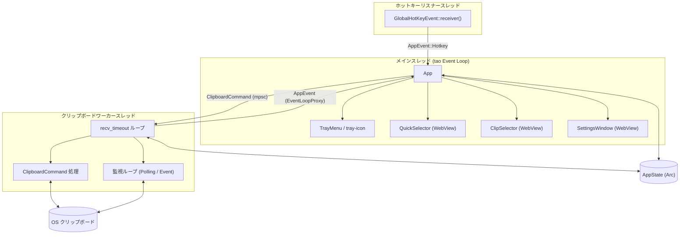

# ClipRefiner 開発者向けドキュメント

ユーザ向けの機能説明・操作方法は [README.md](README.md) を参照してください。設定の詳細は [CONFIG.md](CONFIG.md)、バージョンごとの変更内容は [CHANGELOG.md](CHANGELOG.md) を参照してください。

## 目次

- [前提条件](#前提条件)
- [ソースからのビルド](#ソースからのビルド)
- [Windows パッケージ作成](#windows-パッケージ作成)
- [開発・テスト](#開発テスト)
- [品質チェック](#品質チェック)
- [ライブラリとしての利用](#ライブラリとしての利用)
- [プロジェクト構成](#プロジェクト構成)
- [スレッドモデル](#スレッドモデル)
- [ログ](#ログ)
- [リリースと変更履歴](#リリースと変更履歴)
- [コーディング規約](#コーディング規約)

---

## 前提条件

- [Rust / Cargo](https://www.rust-lang.org/tools/install) (edition 2024、Rust 1.96 以上。`rust-toolchain.toml` でピン留め)
- [cargo-deny](https://github.com/EmbarkStudios/cargo-deny) (サプライチェーン監査。`cargo install cargo-deny --locked`)

対応 OS は **Windows** のみ。

---

## ソースからのビルド

```bash
git clone <repository_url>
cd clip-refiner
cargo build --release
```

バイナリは `target/release/ClipRefiner.exe` に生成される。ビルドスクリプト `scripts/windows/build.ps1` も利用できる。

---

## Windows パッケージ作成

### Windows MSI

`cargo-wix` と WiX Toolset v3 を使って MSI を作成できる。

```powershell
# 前提: cargo install cargo-wix --locked
#       winget install WiXToolset.WiXToolset
./scripts/windows/build-msi.ps1
```

出力先: `target/wix/clip-refiner-{version}-{arch}.msi` (per-user インストール、日本語 UI)

---

## 開発・テスト

```bash
# 単体テスト・統合テストを実行 (デフォルト feature `app` で統合テストも含む)
cargo test

# 特定の統合テストのみ実行
cargo test --test monitor_flow
cargo test --test settings_flow
cargo test --test clips_flow

# ライブラリ API のドキュメントを生成
cargo doc --no-deps --open
```

加工ロジックは `clip_refiner` ライブラリクレートとしても利用できる。

```rust
use clip_refiner::{RefineContext, RefineMode, Refiner};

let ctx = RefineContext::default();
let output = RefineMode::UrlDecode.refine("hello%20world", &ctx);
assert_eq!(output, "hello world");
```

統合テスト (`crates/clip-refiner/tests/`) では監視ループ・ワーカー・履歴・正規表現・連続記録・登録クリップの主要経路を検証する。`ClipboardHarness` が監視ループとワーカーコマンドを横断的に駆動する。

| ファイル | 検証内容 |
| :------- | :------- |
| `monitor_flow.rs` | 監視加工、Undo、一時停止、履歴上限、同一テキストの再加工抑制、自身の書き戻しスキップ、パイプライン |
| `worker_flow.rs` | 手動加工 (`ProcessMode`)、変更なし加工、Undo 空実行、履歴復元後の再加工抑制 (Polling / Event) |
| `history_flow.rs` | 暗号化履歴の記録・重複処理・復号 |
| `regex_flow.rs` | `config` の正規表現設定、コンパイルキャッシュ、Event 方式 |
| `ocr_flow.rs` | OCR 結果のクリップボード書き込みと再加工抑制 |
| `record_flow.rs` | 連続記録キュー (FIFO、貼り付け排出、履歴との独立性) |
| `clips_flow.rs` | 登録クリップの保存・コピーと再加工抑制 |
| `settings_flow.rs` | 設定ウィンドウ IPC のマージ・パッチ適用・パイプラインとデフォルトモード |
| `regex_preview_logic.rs` | 設定 UI の正規表現プレビュー JS ロジック (Node.js 実行。未インストール時はスキップ) |
| `library_api.rs` | クレートルート re-export と core 連携 |

### テスト用ヘルパー (`test_helpers`)

`clip_refiner::test_helpers` はデバッグビルド、`cargo test` 実行時、または `test-helpers` feature 有効時に利用可能 (feature `app` が必要)。リリースビルドで Clippy やドキュメントテストを走らせる場合は `--features test-helpers` を付ける。

| モジュール | 所在 | 内容 |
| :--------- | :--- | :--- |
| `clip_refiner::test_helpers` | `clip-refiner/src/test_helpers/` | アプリ層の統合テスト用 (`ClipboardHarness`, `SettingsTestContext` など) |
| `clip_refiner_core::test_helpers` | `clip-refiner-core/src/test_helpers/` | コア単体テスト用 (`InMemoryTextClipboard`, `with_temp_config_dir`) |

アプリ側の `test_helpers` は core のヘルパーを re-export する。設定ディレクトリを触るテストは `with_temp_config_dir` で一時ディレクトリへ切り替える。

#### `ClipboardHarness`

監視ループ (`handle_clipboard_update`) とワーカーコマンド (`handle_command`) を、OS クリップボードなしで横断検証するハーネス。`InMemoryTextClipboard` と `AppState` (テスト用初期化) を束ね、本番と同じ処理関数を直接呼び出す。

```rust
use clip_refiner::RefineMode;
use clip_refiner::test_helpers::ClipboardHarness;

let mut harness = ClipboardHarness::with_text("  hello  ")
    .with_mode(RefineMode::Trim);

assert!(harness.run_monitor_update(false));
assert_eq!(harness.clipboard_text(), "hello");

harness.undo();
assert_eq!(harness.clipboard_text(), "  hello  ");
```

**ビルダー (設定の事前セット)**

| メソッド | 用途 |
| :------- | :--- |
| `with_mode` | 監視・手動加工のデフォルトモード |
| `with_pipeline` | 監視時の加工パイプライン |
| `with_history` | 履歴の有効・無効 |
| `with_continuous_record` | 連続記録の有効・無効 |
| `with_paused` | 監視の一時停止 |
| `with_monitor_mode` | `MonitorMode::Polling` / `Event` |

**監視ループ経路**

| メソッド | 本番の対応 |
| :------- | :--------- |
| `run_monitor_update(event_driven)` | 監視ループ 1 ティック (`event_driven` は OS イベント有無) |
| `run_configured_monitor_update()` | 設定の `monitor_mode` に応じた `event_driven` で実行 |
| `replace_clipboard` / `reset_clipboard` | 外部コピー・クリップボード差し替えの模倣 |

戻り値 `bool` は加工が実行されたか (`handle_clipboard_update` と同じ)。

**ワーカーコマンド経路** (`ClipboardCommand` 相当)

| メソッド | コマンド |
| :------- | :------- |
| `process_mode` | `ProcessMode` |
| `set_text` | `SetText` (履歴復元) |
| `set_ocr_text` | `SetOcrText` |
| `undo` | `Undo` |
| `register_clip_from_clipboard` | `RegisterClipFromClipboard` |
| `copy_registered_clip` | `CopyRegisteredClip` |
| `discharge_continuous_record_on_paste` | `paste_watcher::try_paste_continuous_record_front` (`Ctrl+V` 検知経路と同じ) |
| `discharge_continuous_record_at` | `DischargeContinuousRecordAt` |
| `catch_up_continuous_record` | `CatchUpContinuousRecord` |

**検証用アクセサ**

`clipboard_text`, `history_len`, `history_entries`, `continuous_record_len`, `continuous_record_entries`, `registered_clip_count`, `registered_clip_text`, `take_undo_source`, `matches_last_written`, `with_config_mut` など。

新しい統合テストを追加するときは、既存の `*_flow.rs` に近い経路かどうかでファイルを選び、監視とワーカーの両方にまたがるケースは `ClipboardHarness` で往復検証する。設定ウィンドウの IPC とパッチ適用は `SettingsTestContext` を使う。

#### `SettingsTestContext`

設定ウィンドウの `apply` IPC・適用待ちキューのマージ・`config.toml` へのパッチ反映を、WebView なしで検証するヘルパー。`TrayMenu` とスタブ `ClipboardWorkerHandle` を束ね、本番と同じ `apply_settings_patch_without_ui` を呼び出す。

```rust
use clip_refiner::test_helpers::SettingsTestContext;

let ctx = SettingsTestContext::new();

assert!(ctx.apply_ipc(r#"{"type":"apply","patch":{"historyEnabled":true}}"#));
assert!(ctx.state().with_config(|c| c.history_enabled));
```

| メソッド | 用途 |
| :------- | :--- |
| `enqueue_apply_ipc` | JSON IPC の `apply` を適用待ちキューへ積む |
| `enqueue_patch_json` | 部分更新 JSON をキューへ積む (マージ検証用) |
| `take_pending_patch_json` | マージ済みパッチ JSON を取り出す |
| `apply_pending_patch` | キューから取り出して反映 |
| `apply_ipc` | JSON IPC を解釈して即時反映 |
| `state` / `menu` | 検証用アクセサ |

---

## 品質チェック

Windows の `check` スクリプト (`scripts/windows/check.ps1`) で、整形・Clippy・サプライチェーン監査・テストを一括実行できる。

個別コマンド:

```bash
cargo fmt --check
cargo clippy --all-targets --features test-helpers -- -D warnings
cargo deny check
cargo test --all-targets --features test-helpers
cargo test --doc --features test-helpers
```

### サプライチェーン監査 (`cargo-deny`)

[`deny.toml`](deny.toml) で依存関係の脆弱性・ライセンス・取得元を検証する。`check` スクリプトは `cargo deny check` を含む。

| チェック | 内容 |
| :------- | :--- |
| **advisories** | RustSec 公表の脆弱性・yanked crate。`unmaintained` はワークスペース直接依存のみ失敗 |
| **licenses** | 商用利用可能なパーミッシブライセンスのみ許可 (GPL / LGPL / MPL 等のコピーレフトは拒否) |
| **bans** | 同一 crate の多重バージョンなど |
| **sources** | crates.io 以外のレジストリ / git 依存の拒否 |

`graph.all-features` と Windows ターゲット (`x86_64-pc-windows-msvc`) を対象に、feature `app` 有効時の依存グラフを検査する。

許可リストはパーミッシブライセンス (MIT / Apache-2.0 / BSD 等) のみ。コピーレフト (GPL / LGPL / MPL 等) は拒否する。

### 第三者ライセンス表示 (`THIRD_PARTY_NOTICES`)

`LICENSE` は ClipRefiner 本体 (All Rights Reserved) の利用条件のみを示す。配布バイナリに含まれる OSS 依存の帰属・ライセンス全文は **`THIRD_PARTY_NOTICES`** にまとめる。

| 項目 | 内容 |
| :--- | :--- |
| 生成ツール | [cargo-about](https://github.com/EmbarkStudios/cargo-about) (`cargo install cargo-about --locked --features cli`) |
| 設定 | [`about.toml`](about.toml)、テンプレート [`scripts/templates/third-party-notices.hbs`](scripts/templates/third-party-notices.hbs) |
| 手動生成 | `scripts/common/generate-third-party-notices.ps1` |
| 出力 | リポジトリルートの `THIRD_PARTY_NOTICES` (`.gitignore` 対象。パッケージ作成時に自動生成) |

パッケージへの同梱:

| プラットフォーム | 同梱先 |
| :--------------- | :----- |
| **Windows MSI** | `%LOCALAPPDATA%\ClipRefiner\THIRD_PARTY_NOTICES` (`build-msi.ps1` が生成後に同梱) |

---

## ライブラリとしての利用

`ClipRefiner` はデスクトップ常駐アプリが主用途だが、加工ロジックは GUI 非依存の **`clip-refiner-core`** クレート (`clip_refiner_core`) として他プロジェクトから呼び出せる。`clip-refiner` パッケージは core を re-export しており、feature `app` (デフォルト有効) でトレイ常駐 UI と `run()` を追加する。

ライブラリ API は [Semantic Versioning](https://semver.org/lang/ja/) に従い、破壊的変更は [CHANGELOG.md](CHANGELOG.md) の **Breaking changes** 節に記載する。

### 依存の追加

GUI 依存 (`tao`, `wry`, `tray-icon` など) を避ける場合は、次のいずれかを使う。

**推奨: core クレートを直接依存**

```toml
[dependencies]
clip-refiner-core = { path = "crates/clip-refiner-core" }
```

**互換: `clip-refiner` で feature を無効化**

```toml
[dependencies]
clip-refiner = { path = "..", default-features = false }
```

Rust コード上のクレート名はいずれも `clip_refiner` (re-export) または `clip_refiner_core` を使える。

### 公開 API 一覧

| 種別 | 名前 | 説明 |
| :--- | :--- | :--- |
| モジュール | `refiner` | 加工モードとテキスト / クリップボード加工 |
| モジュール | `config` | 設定型と `config.toml` 永続化 |
| 加工 | `RefineMode`, `RefineCategory`, `Refiner` | 単一モードの適用 |
| 加工 | `apply_text_pipeline`, `apply_pipeline_to_text` | 複数モードの連鎖適用 |
| 加工 | `split_pipeline` | テキスト用モード列と末尾画像モードの分割 |
| クリップボード | `process_clipboard`, `process_clipboard_pipeline` | `arboard::Clipboard` への読み書き |
| 結果 | `ClipboardProcessOutcome`, `ClipboardProcessError` | 加工結果と失敗理由 |
| 設定 | `AppConfig`, `RegexSettings`, `HotkeySettings` など | `config.toml` 対応型 |
| 設定 | `AppConfig::load` (`ConfigLoadOutcome`)、`AppConfig::save`, `AppConfig::reload_from_disk` | 設定ファイル I/O |
| 設定 | `RefineContext::from_config`, `RefineContext::with_regex` | 加工時コンテキスト構築 |
| 定数 | `CONFIG_VERSION` | 設定スキーマの現行バージョン |
| 上限 | `is_within_clipboard_limit`, `is_within_parser_limit` | 入力サイズ検証 |
| アプリ | `run()` | トレイ常駐アプリ全体の起動 (feature `app` が必要) |

### 使用例

単一モード:

```rust
use clip_refiner::{RefineContext, RefineMode, Refiner};

let ctx = RefineContext::default();
let output = RefineMode::UrlDecode.refine("hello%20world", &ctx);
assert_eq!(output, "hello world");
```

加工パイプライン:

```rust
use clip_refiner::{apply_text_pipeline, RefineContext, RefineMode};

let ctx = RefineContext::default();
let result = apply_text_pipeline(
    "  %E3%81%82  ",
    &[RefineMode::UrlDecode, RefineMode::Trim],
    &ctx,
);
assert_eq!(result.as_deref(), Some("あ"));
```

設定連携:

```rust
use clip_refiner::{AppConfig, RefineContext, apply_text_pipeline};

let load_outcome = AppConfig::load();
let config = load_outcome.config;
let ctx = RefineContext::from_config(&config);
let pipeline = config.effective_pipeline();
let _ = apply_text_pipeline("  hello  ", &pipeline, &ctx);
```

詳細は `cargo doc --open` で生成される API ドキュメントを参照。

---

## プロジェクト構成

```
clip-refiner/
├── Cargo.toml           # workspace ルート (virtual manifest)
├── crates/
│   ├── clip-refiner/    # デスクトップアプリ (バイナリ + tray)
│   │   ├── src/
│   │   │   ├── platform/    # OS 連携 (通知・自動起動・OCR・画面キャプチャ)
│   │   │   ├── test_helpers/ # 統合テスト用 (`ClipboardHarness` など)
│   │   │   ├── tray/        # 常駐 UI・ワーカー・ホットキー・設定ウィンドウ・画面 OCR UI
│   │   │   └── ui/          # WebView UI (セレクター・設定ウィンドウ)
│   │   ├── tests/           # 統合テスト (`*_flow.rs`)
│   │   └── build.rs
│   └── clip-refiner-core/   # 加工ロジック・設定型 (GUI 非依存)
│       └── src/
│           ├── config/
│           ├── platform/    # DPAPI・クリップボード画像など GUI 非依存の OS 連携
│           ├── refiner/
│           ├── security/
│           └── test_helpers/ # コア単体テスト用
├── assets/
├── scripts/
│   ├── common/          # 共通ヘルパー (cargo-deny、THIRD_PARTY_NOTICES 生成など)
│   └── windows/         # ビルド・品質チェック (check.ps1 など)
├── CONFIG.md
└── wix/
```

`clip-refiner` の `platform/` は Win32 / WinRT 依存の機能を集約する。`clip-refiner-core` の `platform/` は暗号化キー保護やクリップボード画像取得など、ライブラリ利用時にも必要な最小限の OS 連携のみを置く。

セレクター UI (`src/ui/`) は WebView 上で動作する。クイックセレクタ・登録クリップセレクタは `selector-common.js` に共通ロジックを集約している。設定ウィンドウ (`src/ui/settings/`) は `regex_preview.js`・`shared.js` などの分割 JS を Rust 側で組み立ててインライン展開する。

---

## スレッドモデル

監視モード (引数なし起動) では、クリップボード操作を単一スレッドに集約し、UI は `tao` のイベントループ上で動作する。各スレッドの役割と通信経路は次のとおり。



### 各コンポーネント

| コンポーネント | スレッド | 責務 |
| :------------- | :------- | :--- |
| **Event Loop** (`tray/runner.rs`) | メイン | ウィンドウイベント、トレイメニュー、WebView IPC (セレクター・設定ウィンドウ)、`AppEvent` の受信と `App::handle_event` への振り分け |
| **Hotkey Listener** (`tray/hotkey.rs`) | 専用 | `global-hotkey` のイベントをブロッキング受信し、`EventLoopProxy` 経由で `AppEvent::Hotkey` をメインスレッドへ送る |
| **Clipboard Worker** (`tray/worker/`) | 専用 | すべてのクリップボード読み書き、監視ループ、設定ファイルの外部変更ポーリング。`recv_timeout` でコマンド受信と監視チックを交互に処理 |
| **AppState** (`tray/state/`) | 共有 (`Arc`) | 設定 (`RwLock`)、加工済み状態・履歴・Undo 用テキスト (`Mutex`)。UI とワーカーの両方から参照 |

### 通信の要点

- **UI → ワーカー**: `ClipboardCommand` を `mpsc` チャネルで送信 (手動加工、履歴復元、登録クリップコピーなど)
- **ワーカー → UI**: `EventLoopProxy<AppEvent>` でユーザーイベントを送る (例: 設定再読み込み完了)
- **ホットキー → UI**: 専用スレッドが `AppEvent::Hotkey` を送り、メインスレッドの `HotkeyHandler` が処理
- **クリップボード**: `arboard::Clipboard` はワーカースレッド内の 1 インスタンスのみが触る (競合回避)

加工ロジック自体 (`refiner/`) はスレッドを持たず、ワーカーまたはワンショット実行 (`bootstrap.rs`) から同期的に呼ばれる。

### デスクトップ通知

通知の呼び出しは 2 層に分ける。

| 層 | モジュール | 責務 |
| :--- | :--------- | :--- |
| **platform** | `platform/notify.rs` | Windows トーストの初期化と送信 (`init_notifications`, `show_notification`) |
| **tray** | `tray/notify/message.rs` | 加工完了・一時停止など設定連動の本文組み立て (`show_process_notification`, `show_when_enabled` など) |

- エラー表示・履歴復元・ホットキー案内など固定メッセージは、呼び出し元から `platform::show_notification` を直接使う
- 監視モードの加工完了は `tray/notify` が `NotificationSettings` を反映して本文を組み立て、最終的に `platform::show_notification` へ渡す
- 起動時は `bootstrap.rs` で `init_notifications` を呼び、AUMID とアイコンを登録してから各所でトーストを送る

---

## ログ

ログファイルは設定ディレクトリ内の `logs/` フォルダに日次ローテーションで保存される (保存場所は [CONFIG.md のログ節](CONFIG.md#ログ) を参照)。

ログレベルは環境変数 `RUST_LOG` で制御できる (例: `RUST_LOG=debug`)。

| ビルド種別 | 出力先 |
| :--------- | :----- |
| デバッグビルド (`cargo build` / `cargo run`) | ログファイル + 標準出力 |
| リリースビルド | ログファイルのみ |

---

## リリースと変更履歴

バージョンごとの利用者向け変更内容は [CHANGELOG.md](CHANGELOG.md) に記載する ([Keep a Changelog](https://keepachangelog.com/ja/1.1.0/) 形式)。

リリース作業の目安:

1. `Cargo.toml` の `version` を更新し、Git タグ `v{version}` を付与する
2. [CHANGELOG.md](CHANGELOG.md) の `[Unreleased]` 節を新バージョン見出し (`## [x.y.z] - YYYY-MM-DD`) へ移し、空の `[Unreleased]` を用意する
3. 設定スキーマ (`consts::CONFIG_VERSION`) を変更したリリースでは、CHANGELOG の **設定** 節に移行内容を書く
4. ユーザ向けの大きな変更があれば [README.md](README.md) / [CONFIG.md](CONFIG.md) も合わせて更新する
5. パッケージ作成スクリプト (`build-msi.ps1`) は `THIRD_PARTY_NOTICES` を自動生成して同梱する

---

## コーディング規約

リポジトリ内の `.cursor/rules/` に、次の規約が定義されている。

| ファイル | 内容 |
| :------- | :--- |
| `imports.mdc` | `use` 文のグループ順・空行・アルファベット順 |
| `comments.mdc` | コメントの文体 (常体)、セクション区切り、`///` の書き方 |

Pull Request 前に [品質チェック](#品質チェック) を通すこと。
