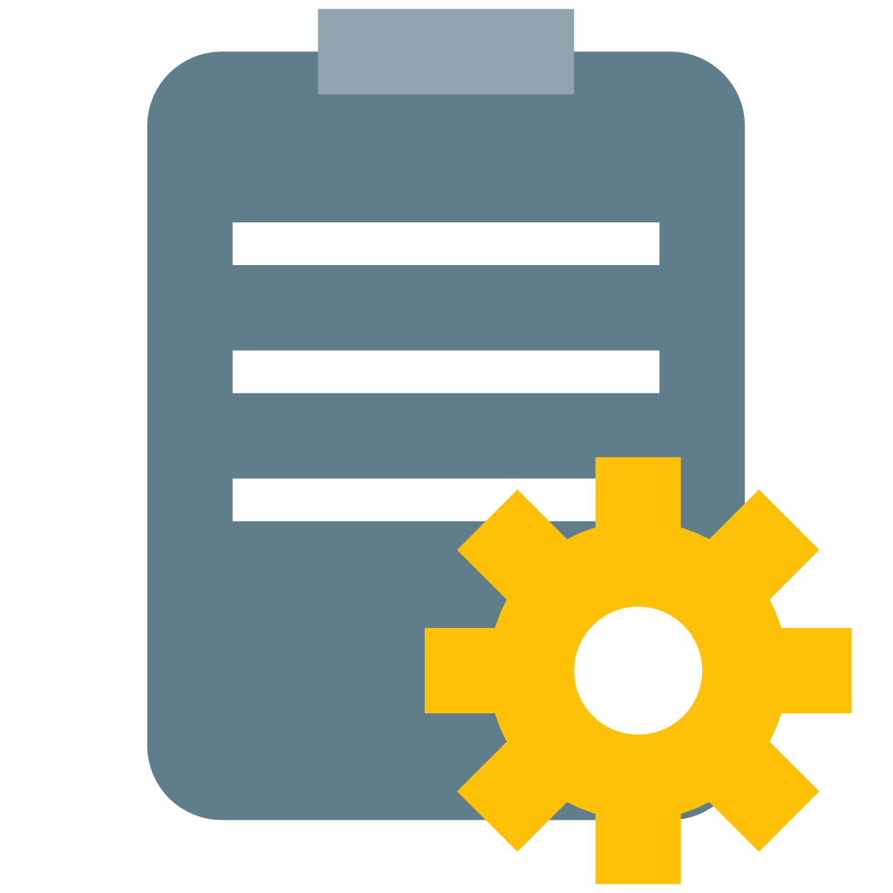

<div align="center">



# ClipRefiner

<p>
  <strong>コピーしたテキストを、ホットキーひとつで整形・変換する Windows 常駐ツール。コピーのたびの自動変換にも対応</strong>
</p>

<p>
  
  <a href="https://github.com/GnudMna/clip-refiner/releases/latest"></a>
  
  
  
  <a href="LICENSE"></a>
</p>

</div>

---

## できること

### 変換する

- **55 種類の変換モード:** URL・Base64・JSON / YAML・Markdown / HTML・Excel の表・日時・全角 / 半角・識別子のケースなど ([変換モード一覧](docs/user/modes.md#変換モード一覧))
- **自動変換:** コピーのたびに、選んだモードで変換する (新規インストールでは無効)
- **クイックセレクター:** `Alt+Shift+S` でモードを検索し、今のクリップボードだけを変換する
- **お気に入り:** よく使うモードを専用のホットキーに割り当てる (最大 20 件)
- **加工パイプライン・正規表現プリセット:** 最大 10 段のモードの連鎖と、名前を付けて保存する置換・抽出のルール
- **ワンショット:** コマンドラインから 1 回だけ変換する

### コピーと貼り付けを助ける

- **登録クリップ:** よく使うテキスト・画像を保存し、`Alt+Shift+T` ですぐコピーする。日付などを差し込むテンプレートにも対応
- **連続記録モード:** コピーした順にためておき、`Alt+Shift+X` で先頭から貼り付ける
- **履歴・加工の取り消し:** 過去の加工結果を呼び出す。直前の加工は `Alt+Shift+Z` で元に戻せる
- **画面 OCR:** `Alt+Shift+G` で画面の範囲を選び、文字を読み取ってコピーする

### 安全に使う

- 履歴と連続記録はディスクに書かず、メモリ上でも暗号化して持つ。登録クリップは暗号化して保存する
- パスワードマネージャーのコピーは監視しない。手動で加工した結果も Win+V 履歴やクラウド同期に載せない
- 通知やプレビューでは、API キーなど機密らしい内容を伏せて表示する (クリップボードの中身は変えない)
- アプリの更新は、署名とハッシュを検証してから適用する

詳しくは [セキュリティ](docs/user/security.md) を参照。

---

## インストール

[リリースページ](https://github.com/GnudMna/clip-refiner/releases) から MSI またはポータブル ZIP を入手する。対応 OS は Windows (x64)。

| 形態 | 特徴 |
| :--- | :--- |
| **MSI** | `%LOCALAPPDATA%\ClipRefiner` へユーザー単位でインストールする (管理者権限は不要)。ユーザー `PATH` への追加とログイン時の自動起動をインストーラーで選べる |
| **ポータブル ZIP** | 展開して `ClipRefiner.exe` を起動する。設定とログは同じフォルダの `data\` に保存する ([ポータブルモード](docs/user/configuration.md#ポータブルモード)) |

- 設定とログの保存先は、MSI では `%APPDATA%\ClipRefiner`、ポータブルでは `data\`
- 設定ウィンドウとセレクターの表示には [Microsoft Edge WebView2 Runtime](https://developer.microsoft.com/microsoft-edge/webview2/) が必要 (通常は導入済み)。無くても監視・ホットキー・ワンショットは使える
- `ClipRefiner.exe` だけを別のフォルダへ複製すると、アプリ内から更新できない (同じフォルダに `ClipRefinerUpdater.exe` が必要)

ソースからビルドする場合は [開発環境とビルド](docs/dev/setup.md#ソースからのビルド) を参照。

---

## クイックスタート

1. スタートメニューの **ClipRefiner**、または `ClipRefiner.exe` を起動する。ウィンドウは開かず、通知領域 (システムトレイ) に常駐する
2. テキストをコピーし、`Alt+Shift+S` でクイックセレクターを開く。モードを選んで `Enter` を押すと、今のクリップボードだけを変換する
3. コピーのたびに自動で変換したいときは、クイックセレクターで `Ctrl+Enter` を押すか、トレイメニューの **変換モード** からモードを選ぶ
4. 自動変換を止めるには、トレイメニューの **変換モード → 自動変換を有効にする** のチェックを外す
5. 細かい設定は、トレイメニューの **設定を開く** から行う

### コマンドラインから使う

```powershell
.\ClipRefiner.exe -m url-decode                # 1 回だけ変換して終了する
.\ClipRefiner.exe --pipeline url-decode trim   # 複数のモードを順に適用する
```

モード名は、コマンドラインでは kebab-case (`url-decode`)、`config.toml` では PascalCase (`UrlDecode`) で書く。オプションの一覧は [使い方](docs/user/usage.md#コマンドラインオプション) を参照。

---

## 既定のホットキー

設定ウィンドウの「ショートカット」タブで変更できる ([ホットキー形式](docs/user/configuration.md#ホットキー形式))。

| ホットキー | 動作 |
| :--- | :--- |
| `Alt+Shift+S` | クイックセレクター |
| `Alt+Shift+T` | 登録クリップセレクター |
| `Alt+Shift+G` | 画面 OCR |
| `Alt+Shift+P` | 自動変換の有効 / 無効 |
| `Alt+Shift+Z` | 加工の取り消し |
| `Alt+Shift+C` | 連続記録モードの有効 / 無効 |
| `Alt+Shift+X` | 連続記録モードで、先頭の記録を貼り付け |
| `Alt+Shift+Backspace` | 連続記録モードで、直近の記録を取り消し |
| `Alt+Shift+N` | デスクトップ通知の有効 / 無効 (エラー通知は常に表示) |
| `Alt+Shift+Q` | 終了 |
| `Alt+Shift+1`〜`Alt+Shift+9`, `Alt+Shift+F1`〜`Alt+Shift+F11` | お気に入りのモードを今のクリップボードへ適用 (登録順) |

---

## ドキュメント

### 利用者向け

| ドキュメント | 内容 |
| :--- | :--- |
| [使い方](docs/user/usage.md) | トレイ・設定ウィンドウ・セレクター・登録クリップ・履歴・連続記録モード・OCR・更新 |
| [設定リファレンス](docs/user/configuration.md) | `config.toml` の場所・設定項目と既定値・処理の制限・ホットキー形式 |
| [変換モード](docs/user/modes.md) | 全 55 モードの一覧と使用例 |
| [セキュリティ](docs/user/security.md) | 履歴・登録クリップの保護、監視除外、表示マスキング、更新の検証 |
| [トラブルシューティング](docs/user/troubleshooting.md) | 症状別の確認事項 |
| [CHANGELOG.md](CHANGELOG.md) | バージョンごとの変更履歴 |

### 開発者向け

| ドキュメント | 内容 |
| :--- | :--- |
| [開発環境とビルド](docs/dev/setup.md) | 前提条件・ビルド・MSI / ポータブル ZIP の作成・環境変数 |
| [テストと品質チェック](docs/dev/testing.md) | テストの構成・E2E・ファジング・ベンチマーク・`check.ps1`・Git フック・リンター |
| [アーキテクチャ](docs/dev/architecture.md) | プロジェクト構成・モジュールの責務・スレッドモデル・ログ |
| [リリース](docs/dev/release.md) | 準備・`release.ps1`・リリース後の作業・更新署名鍵 |
| [開発への参加](docs/dev/contributing.md) | Git 運用・コーディング規約・ドキュメント同期 |
| [clip-refiner-core](crates/clip-refiner-core/README.md) | 加工ロジックをライブラリとして使う |

---

## ライセンス

[MIT License](LICENSE)
