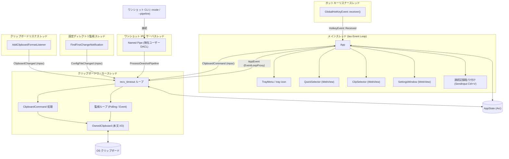

# アーキテクチャ

リポジトリとクレートの構成、モジュールの責務、スレッドモデルをまとめる。

## プロジェクト構成

```
clip-refiner/
├── Cargo.toml           # workspace ルート (virtual manifest / `workspace.dependencies`)
├── package.json         # UI JavaScript の ESLint / Prettier / Playwright E2E (本番バイナリには同梱しない)
├── eslint.config.js
├── e2e/                 # Playwright + WebView2 CDP による設定 / セレクター E2E
│   ├── fixtures.ts
│   ├── playwright.config.ts
│   └── *.spec.ts
├── fuzz/                # パーサ系変換の cargo-fuzz ターゲット (nightly。ワークスペース外)
│   ├── fuzz_targets/
│   └── src/lib.rs       # 共通処理 (パニック時の入力保存)
├── crates/
│   ├── clip-refiner/    # デスクトップアプリ (バイナリ + tray)。core API は re-export しない
│   │   ├── src/
│   │   │   ├── bootstrap/   # 常駐 / ワンショット起動分岐 (args / logging / panic_hook / instance / oneshot / portable)
│   │   │   ├── ipc/         # ワンショット ↔ 常駐の名前付きパイプ IPC (`protocol` / `client` / `server`。`ClientError` は test-helpers / debug 向け)
│   │   │   ├── platform/    # デスクトップ常駐向け OS 連携 (通知・自動起動・OCR・WebView2・更新)
│   │   │   │   └── update/  # 確認 (check/) / 埋め込みキー復号 (bridge_key) / digest・署名検証 (signature) / MSI・ポータブル適用
│   │   │   ├── test_helpers/ # 統合テスト用 (`ClipboardHarness` / oneshot IPC / update など)
│   │   │   ├── tray/        # 常駐 UI・ワーカー・ホットキー・設定ウィンドウ
│   │   │   │   ├── features/    # トレイメニュー機能ドメイン (menu + event、`update.rs` 含む)
│   │   │   │   ├── menu/        # TrayMenu 型・全体構築・同期・履歴/連続記録 rebuild
│   │   │   │   ├── event/       # イベントループ制御・ルーティング
│   │   │   │   ├── selector/    # クイック/登録クリップセレクター WebView (retention 含む)
│   │   │   │   ├── settings/    # 設定ウィンドウ (model, ipc/, window/, apply/, snapshot など)
│   │   │   │   ├── worker/      # クリップボードワーカー・監視ループ・OS リスナ
│   │   │   │   └── ...
│   │   │   ├── logger.rs    # 日次ローテーション付きファイルログ
│   │   │   ├── user_error.rs # UpdateError 等から UserNotification を生成
│   │   │   └── ui/          # WebView UI (セレクター・設定ウィンドウ)
│   │   ├── tests/           # 統合テスト (`*_flow.rs`)
│   │   └── build.rs
│   └── clip-refiner-core/   # 加工ロジック・設定型 (GUI 非依存)。ライブラリ利用はこちら
│       ├── README.md    # ライブラリとしての利用
│       ├── benches/     # 変換の処理時間ベンチマーク (criterion)
│       └── src/
│           ├── clip_template.rs # 登録クリップのテンプレート展開 (`{date}` など。feature 非依存)
│           ├── config/      # types/hotkeys/ ・ persistence/ (load/save) ・ serialize ・ spec (ドキュメント同期テスト) など
│           ├── native/      # DPAPI (`config`)・クリップボード画像と監視除外フォーマットの判定 (`clipboard`)。変換のみでは未コンパイル
│           ├── refiner/     # 変換モード・パイプライン・`OwnedClipboard`
│           │   └── transform/regex/  # キャッシュ / マッチタイムアウト / 実行パス / プレビュー
│           ├── security/
│           └── test_helpers/ # コア単体テスト用
├── .claude/             # Claude Code 向けの共有設定 (settings.json) と規約 (rules/)
├── assets/
├── keys/
│   └── update-signing/  # 更新署名の minisign 公開鍵 (`*.pub`。build.rs が埋め込む)
├── scripts/
│   ├── common/          # 実装ヘルパー (cargo / npm / build-ui.mjs / wix / MSI 検証など)
│   ├── git/hooks/       # Git フック (pre-commit / pre-push)
│   ├── templates/       # THIRD_PARTY_NOTICES のテンプレート
│   └── windows/         # 開発者向けエントリポイント (check.ps1, format.ps1 など)
├── wix/                 # MSI 定義 (main.wxs)
├── about.toml           # cargo-about 設定
├── deny.toml            # cargo-deny 設定
├── CLAUDE.md            # Claude Code 向けの作業指針
├── CHANGELOG.md
├── README.md
└── docs/
    ├── user/            # 利用者向け (使い方・設定リファレンス・変換モード・セキュリティ・トラブルシューティング)。mdBook の原稿で、MSI / ZIP に HTML で同梱
    └── dev/             # 開発者向け (環境構築・テスト・アーキテクチャ・リリース・開発規約)
```

第三者クレートと `clip-refiner-core` の版はルート `Cargo.toml` の `[workspace.dependencies]` に置く。メンバ側は `workspace = true` とし、`optional` や追加 `features` だけを各 `Cargo.toml` に書く。

`clip-refiner` の `platform/` はデスクトップ常駐向けの Win32 / WinRT 依存機能を `windows` クレート経由で集約する。`platform/update/` は gh-release-bridge の version API 取得・アセットのダウンロードと検証・MSI / ポータブル ZIP の適用を担う (利用者向けは [アプリの更新](../user/usage.md#アプリの更新))。`clip-refiner-core` の `native/` は feature `config` の DPAPI と feature `clipboard` のクリップボード画像など、ライブラリ利用時にも必要な最小限のネイティブ OS API のみを置く (`default-features = false` ではコンパイルしない。`platform/` とは名前を分け、GUI 連携との混同を避ける)。`ipc/` は常駐プロセスがサーバー、`--mode` / `--pipeline` 実行側がクライアントとなり、パイプは現在ユーザー専用 DACL と `PIPE_REJECT_REMOTE_CLIENTS` で保護し、名前に `.<ログオンセッション ID>` を付けてセッションごとに分ける (多重起動防止の mutex がセッション単位のため。利用者向けは [ワンショット IPC](../user/security.md#ワンショット-ipc))。

本書のパス (構成図・表の 1 列目・バッククォートで囲んだパス) は `cargo test` (`tests/architecture_doc_flow.rs`) が実在を検証する。個々のファイルの責務はモジュールコメントに任せ、本書はディレクトリと命名規則の単位で書く。

### WebView UI (`src/ui/`)

セレクター (クイック / 登録クリップ) は `src/ui/` 直下、設定ウィンドウは `src/ui/settings/` に置く。ファイルの役割は命名で区別する。

| 種類 | 責務 |
| :--- | :--- |
| `quick_selector.js` / `clip_selector.js` / `settings/main.js` | esbuild のエントリ。初期化・DOM 操作・IPC 受信・キーボードイベント |
| `*_logic.js`・`selector-common.js`・`html_escape.js` など DOM 非依存のモジュール | 一覧組み立て・検索正規化・パッチ組み立て・再描画判定などの純粋ロジック (ESM)。Node.js 上の統合テスト (`tests/*_logic.rs`) からも `import` で読み込んで検証する |
| その他の `*.js` | DOM を扱う描画・入力イベント・IPC 送信 |
| `*.bundle.js` | esbuild 生成 IIFE (編集禁止。`npm run build:ui` で再生成) |
| `*.html` / `*.css` | シェル HTML とスタイル |

設定ウィンドウの共有ミュータブル状態は `settings/ctx.js` に置き、描画関数の相互参照もここに集約して循環 import を避ける。`settings/css/*.css` は `tray/settings/window/assets.rs` が `base` → `layout` → `fields` → `regex` → `controls` → `lists` の順に連結して埋め込む (カスケード順のため並びを変えない)。

`innerHTML` へ代入してよいのは `escapeHtml` / `highlightText` と、信頼済み HTML を組み立てる関数の戻り値だけとする。許可する関数は `eslint.config.js` の `no-unsanitized` 設定に列挙し、それ以外の代入は ESLint が拒否する。

Rust 側 (`tray/selector/`) は CSS とバンドル JS をインライン展開して `WebView` に渡す (`embed_quick_selector_assets` / `embed_clip_selector_assets`)。設定 / セレクター `WebView` は埋め込み HTML (`NavigateToString`) のみを表示する。CSP で外部 script / connect / frame を禁止し、ナビゲーションハンドラで `http(s)` / `file` 等のページ遷移・`window.open`・ダウンロードを拒否する。初期読み込みは `about:blank` または埋め込んだ HTML と一致する `data:text/html;base64` のみ許可する (`selector/webview_policy.rs`)。

### `tray/` の責務分担

トレイ常駐 UI は **インフラ層** (`menu/`, `event/`, `worker/` など) と **機能ドメイン層** (`features/`, `settings/apply/patch/`) に分ける。新機能を追加するときは、まず `features/` にメニュー構築とクリック処理をまとめ、設定ウィンドウ連携が必要なら `settings/apply/patch/` にパッチ適用を追加する。

| モジュール (`tray/`) | 責務 |
| :------------------- | :--- |
| `features/` | トレイメニュー項目ごとのドメイン実装。各サブモジュールが `menu.rs` (構築・更新) と `event.rs` (クリック処理) を担う (`regex` 含む) |
| `menu/` | `TrayMenu` 型定義、メニュー全体の組み立て・設定同期・履歴 / 連続記録メニュー再構築の共通化・アイコン |
| `event/` | tao イベントループへの委譲 (`loop_event`, `user_event/` ルーター + ドメインハンドラ)、ホットキー・OCR・設定再読み込み、`handle_menu_event` ルーティング。`loop_event` 末尾でセレクター保持同期とアイドル起床 (`ControlFlow::WaitUntil`) |
| `selector/` | クイック / 登録クリップセレクターの WebView 束 (`SelectorUi`)。`retention.rs` が保持方針、`webview_policy.rs` が CSP と遷移許可を担う |
| `settings/` | 設定ウィンドウ (下表参照) |
| `worker/` | クリップボード I/O 集約・監視ループ・コマンド処理。クリップボード変更 (OS 通知とシーケンストークン) と設定ディレクトリ変更の検知もここに置く |
| `state/` | `AppState` (設定・横断操作) とサブ状態アクセサ (`worker` / `clipboard_session` / `config_sync` / `settings_pending`)、メニュー構築用の `MenuSnapshot` (必要フィールドのみ)、`AppEvent` (ドメイン別サブイベントのハブ) |
| `hotkey/` | グローバルホットキー登録・イベント変換 |
| `clipboard_monitor/` | 監視ループの判断・世代管理 |
| `notify/` | デスクトップ通知本文の組み立て (`NotificationSettings` 連動) |
| `history_store/` | 暗号化クリップボード履歴・連続記録のメモリストア (`EncryptedHistoryStore`) |
| `paste_watcher/` | 連続記録の貼り付け補助: キュー先頭書き込みロジックと `SendInput` による `Ctrl+V`。書き込み自体はワーカーの `PasteContinuousRecordFront` が担当 |
| `ocr/` | 画面 OCR キャプチャ連携 (`OcrJobGate` で同時 1 本・旧結果破棄) |
| `app/` | `App` 構造体と起動時初期化 |
| `runner.rs` | tao イベントループの起動と `App` への委譲 |
| `dispatch.rs` | ワーカー・イベントループへの送信ヘルパー |
| `e2e.rs` | `--e2e-window` ハーネス (Playwright E2E 専用) |

`features/` のドメイン一覧:

| サブモジュール (`tray/features/`) | 対応するトレイメニュー / 操作 |
| :-------------------------------- | :---------------------------- |
| `refine` | 変換モード (自動変換の切り替えを含む)・お気に入り (`favorites.rs`) |
| `regex` | 正規表現プリセットのトレイ切替 (変換モード内のサブメニュー) |
| `monitor` | 監視方式の更新 (トレイメニューは持たず、設定ウィンドウから呼ぶ) |
| `clips` | 登録クリップ |
| `history` | 履歴メニュー (有効化・クリア・過去項目の選択) |
| `record` | 連続記録 |
| `update` | 更新確認・適用 (`platform/update/` をバックグラウンド起動。設定 UI から呼ぶ) |
| `app_control` | 終了・一時停止・クイック変換・設定ウィンドウ・監視再開 |

設定ウィンドウの JavaScript は [WebView UI](#webview-ui-srcui) を参照する。Rust 側 (`tray/settings/window/assets.rs`) は `settings.bundle.js` をインライン展開し、シェル DOM ID・全タブ定義・`SettingsPanelsLogic` が含まれることをユニットテストする。読み書き項目は `tray/settings/model.rs` の `SettingsWritable` / `SettingsPatch`、初期表示は `snapshot.rs` の `SettingsSnapshot` が担う。IPC は `tray/settings/ipc/` (メッセージ / キュー / ディスパッチ)、パッチ適用は `tray/settings/apply/patch/` でドメイン別 (監視・履歴・連続記録・正規表現・加工・通知・システム・ホットキー・セレクター WebView) に分割されている。設定変更の反映はパッチ側が `AppConfig` を更新し、実際の `WebView` 破棄同期は `loop_event` の `sync_selector_retention` が担う。

### アプリ更新 (`platform/update/`)

設定「一般」タブは `tray/features/update.rs` から確認・適用経路を呼ぶ。同時実行は `settings_pending` の更新オペレーション排他で 1 本に制限する。

`platform/update/` は、確認 (`check/`)・ダウンロードと検証・署名検証・適用・ポータブル差し替えヘルパー (`replace/`) をサブモジュールに分ける。署名の公開鍵は `build.rs` が `keys/update-signing/*.pub` から埋め込み、ダウンロード認証のキーは `bridge_key` が復号する。検証の仕様 (digest・署名・アセット名・認証) は利用者向けの [アプリ更新の検証](../user/security.md#アプリ更新の検証) を正とし、本書では繰り返さない。

確認・適用の失敗は `UpdateError` (`error.rs`) に集約する。トレイ / 設定 UI 側 (`tray/features/update.rs`) は `Display` 文字列を Outcome へ載せ、デスクトップ通知は `UserNotification` (`user_error.rs`) 経由で送る。

統合テストは `update_flow.rs` と `test_helpers/update.rs` でローカル HTTP モック bridge を立て、`ApplyOptions::TEST` により `msiexec` / 差し替えヘルパー / エクスプローラーを起動しない。隠し CLI `--apply-portable-update` (および `--wait-pid` / `--install-dir` / `--cleanup-dir`) は利用者向けではなく、ポータブル差し替えヘルパー専用である (`--e2e-window` と同様に help では非表示)。

### スクリプト構成

`scripts/windows/` は開発者が直接実行するエントリポイント。実処理は `scripts/common/` のヘルパーに集約する (PowerShell はドットソース、Node は `npm run` から呼ぶ)。`scripts/common/` には cargo / npm / cargo-fuzz / WiX のラッパー、UI バンドル (`build-ui.mjs`)、ターゲット解決と MSI 検証、リリース補助 (バージョン更新・更新署名・`THIRD_PARTY_NOTICES` 生成・利用者向けドキュメントの mdBook ビルドと WiX 断片生成)、共通処理 (終了コード検証・ルートへの移動など) を置く。各ファイルの役割は先頭のコメントに書く。

| `scripts/windows/` | 役割 |
| :----------------- | :--- |
| `check.ps1` | 品質チェック一式 (`-Coverage` でカバレッジ付きテストに切替可) |
| `format.ps1` | rustfmt + Prettier 整形 |
| `test.ps1` / `clippy.ps1` / `coverage.ps1` | 個別の Cargo コマンド (カバレッジは `cargo-llvm-cov`) |
| `fuzz.ps1` | パーサ系変換のファジング (`cargo-fuzz`。`check.ps1` には含めない) |
| `bench.ps1` | 変換の処理時間ベンチマーク (`criterion`。基準の保存と比較。`check.ps1` には含めない) |
| `check-pre-commit.ps1` | pre-commit 用 (`cargo fmt --check`) |
| `build.ps1` / `build-msi.ps1` / `build-portable.ps1` | ビルド・MSI / ポータブル ZIP 作成 |
| `verify-msi.ps1` | MSI 検証の CLI ラッパー |
| `release.ps1` | リリース手順一括実行 (MSI / ポータブル ZIP 含む) |
| `install-hooks.ps1` / `uninstall-hooks.ps1` | Git フック管理 |
| `generate-wix-assets.ps1` | WiX ブランド画像生成 |

## スレッドモデル

監視モード (引数なし起動) では、クリップボード操作を単一スレッドに集約し、UI は `tao` のイベントループ上で動作する。各スレッドの役割と通信経路は次のとおり。



### 各コンポーネント

| コンポーネント | スレッド | 責務 |
| :------------- | :------- | :--- |
| **Event Loop** (`tray/runner.rs`) | メイン | ウィンドウイベント、トレイメニュー、WebView IPC (セレクター・設定ウィンドウ)、`AppEvent` の受信と `App::handle_event` への振り分け。連続記録貼り付けでは `RecordEvent::SendPaste` を受けて `SendInput` で `Ctrl+V` を送る |
| **Hotkey Listener** (`tray/hotkey/`) | 専用 | `global-hotkey` のイベントをブロッキング受信し、`EventLoopProxy` 経由で `HotkeyEvent::Received` をメインスレッドへ送る。連続記録貼り付け (`Alt+Shift+X`) もここで受信し、メインスレッドの `HotkeyHandler` が `PasteContinuousRecordFront` をワーカーへ送る |
| **Paste helper** (`tray/paste_watcher/`) | (ヘルパー) | キュー先頭のクリップボード書き込みロジックと `Ctrl+V` の `SendInput`。専用スレッドは持たない |
| **Clipboard Listener** (`tray/worker/clipboard_listener.rs`) | 専用 | メッセージ専用ウィンドウで `AddClipboardFormatListener` を登録し、`WM_CLIPBOARDUPDATE` を `ClipboardCommand::ClipboardChanged` としてワーカーへ送る。連打は未処理フラグで束ねる。初期化失敗時はワーカーがシーケンストークンの短周期 peek にフォールバックする |
| **Config Watcher** (`tray/worker/config_watcher.rs`) | 専用 | 設定ディレクトリを `FindFirstChangeNotification` で監視し、`ConfigFileChanged` でワーカーを起床する。変更の有無は `config_sync` の本文指紋 (BLAKE3) で判定する。初期化失敗時は約 2 秒ごとの指紋確認にフォールバックする |
| **Oneshot IPC Server** (`ipc/`) | 専用 (+ 接続ごとの一時スレッド) | 名前付きパイプでワンショット要求を受け、`ProcessOneshotPipeline` をワーカーへ委譲する。待受スレッドは接続を一時スレッドへ渡して次インスタンスの待受を続け、同時処理を `MAX_ACTIVE_CONNECTIONS` (4) に制限する (上限中は枠が空くまで次の接続を保留)。要求 1 行の読み取りは `REQUEST_READ_TIMEOUT` (5 秒) で打ち切り、`PeekNamedPipe` で到着済みの分だけを読むため、要求を送らない接続が枠を占有し続けない。手持ちインスタンスが無いときだけ `FILE_FLAG_FIRST_PIPE_INSTANCE` で作成し、名前の先取りを避ける。パイプ名は `ONESHOT_IPC_PIPE_NAME` + `.<セッション ID>` で、CLI は `GetNamedPipeServerSessionId` で作成元が同じセッションか確かめる。待受スレッドの起動に失敗しても常駐は監視を続けたまま通知する。DACL などの保護は [ワンショット IPC](../user/security.md#ワンショット-ipc) を参照 |
| **Clipboard Worker** (`tray/worker/`) | 専用 | すべてのクリップボード読み書き (`OwnedClipboard`)、監視ループ、設定ファイルの外部変更検知。`recv_timeout` でコマンド受信と監視チックを交互に処理。Event / 連続記録かつリスナ稼働時は `ClipboardChanged` / `ConfigFileChanged` で起床する。再起動・破棄時は `Shutdown` 後にリスナ・設定監視とワーカーを join してから戻る |
| **AppState** (`tray/state/`) | 共有 (`Arc`) | 設定 (`RwLock`)、監視世代、イベントプロキシ。履歴・Undo・二重加工防止は `clipboard_session()`、ワーカー稼働は `worker()`、設定ディスク同期は `config_sync()`、設定 UI 適用待ちは `settings_pending()` 経由 |

### UI の遅延生成

クイックセレクター・登録クリップセレクター・設定ウィンドウの各 `WebView` と画面 OCR オーバーレイは起動時には生成せず、初回表示時に作成する。起動時は空シェル (`SettingsWindow::new_shell`・`init_quick_selector` など) のみ保持する。セレクターの非表示後の保持は `selector_webview_retention` で選べる (`Keep` 既定で保持、`DisposeOnHide` で非表示時破棄、`DisposeAfterIdle` で N 分アイドル後に破棄)。非表示は `hide_with_retention`、方針変更後の同期と期限到来破棄は毎ループの `sync_selector_retention`、アイドル起床は `apply_idle_control_flow` (`ControlFlow::WaitUntil`) が担う。設定ウィンドウと画面 OCR オーバーレイは非表示時に破棄する (アイドル時の RSS 削減)。遅延生成のため `App::handle_event` と `SettingsWindow::show` は `EventLoopWindowTarget` を受け取り、OCR オーバーレイの破棄は `OcrEvent::DisposeOverlay` を経由する。ライフサイクルは `selector/{quick,clip,retention}.rs`、`settings/window/`、`tray/ocr/capture.rs`、`platform/ocr_overlay/overlay_window.rs` のユニットテストで検証する。

### 通信の要点

- **UI → ワーカー**: `ClipboardCommand` を `mpsc` チャネルで送信 (手動加工、履歴復元、登録クリップコピー、連続記録貼り付けの書き込みなど)
- **リスナ → ワーカー**: `ClipboardCommand::ClipboardChanged` で Event / 連続記録の監視を起床する
- **設定監視 → ワーカー**: `ClipboardCommand::ConfigFileChanged` で外部編集の再読み込み判定を起床する。本文指紋が最終同期と異なるときだけ `ConfigEvent::Reload` を送る
- **ワンショット CLI → 常駐**: 名前付きパイプで加工要求を送り、サーバーが `ProcessOneshotPipeline` をワーカーへ渡す (監視エコー回避)
- **ワーカー → UI**: `EventLoopProxy<AppEvent>` でユーザーイベントを送る (例: 設定再読み込み完了、`RecordEvent::SendPaste`)
- **ホットキー → UI**: 専用スレッドが `HotkeyEvent::Received` を送り、メインスレッドの `HotkeyHandler` が処理
- **クリップボード**: 本文の読み書きはワーカースレッド内の `OwnedClipboard` 1 インスタンスに集約する (常駐なしワンショットのみ短命に別インスタンスを開く)。連続記録貼り付けもワーカーが書き込み、メインスレッドは `SendInput` のみ担当する。変更検知は役割を分ける
  - `clipboard_seq` / `AddClipboardFormatListener`: `OpenClipboard` なし (または本文非読) の変更通知
  - `OwnedClipboard` (`arboard`): テキスト / 通常画像 / HTML 形式 (`CF_HTML`) の `OpenClipboard` I/O。HTML 形式の有無は `IsClipboardFormatAvailable` で開かずに判定する
  - `native/clipboard_image` (`CF_DIB` / `CF_DIBV5`): Excel 向け短命 Open。同一呼び出しで `arboard` と重ねて開かない

加工ロジック自体 (`refiner/`) は基本的にスレッドを持たず、ワーカーまたはワンショット実行 (`bootstrap/`) から同期的に呼ばれる。例外として正規表現マッチは実行時間上限のために一時スレッドを使うが、同時実行は最大 2 本 (`REGEX_MATCH_MAX_IN_FLIGHT`) に制限する。タイムアウト時はキャンセルを要求し、実行側はマッチ境界で中断してスロットを返す。`regex` クレートは単一の `find` 実行中を打ち切れないため、その探索が終わるまでスレッドが残る場合がある。画面 OCR も範囲確定後に一時スレッドでキャプチャ・認識するが、`OcrJobGate` により同時実行は 1 本に限り、新しい要求で旧ジョブの結果適用を破棄する。

### デスクトップ通知

通知の呼び出しは 2 層に分ける。

| 層 | モジュール | 責務 |
| :--- | :--------- | :--- |
| **platform** | `platform/notify.rs` | Windows トーストの初期化と送信 (`init_notifications`, `show_notification`) |
| **platform** | `platform/webview2.rs` | WebView2 Runtime のレジストリ検出、未導入時の起動通知、導入ページオープン |
| **platform** | `platform/update/` | 更新確認・digest / 署名検証・MSI / ポータブル適用。失敗は `UpdateError`。通知文言は呼び出し元が `UserNotification` 経由で送る |
| **tray** | `tray/notify/message.rs` | 加工完了・一時停止など設定連動の本文組み立て (`show_process_notification`, `show_when_enabled` など) |
| **app** | `user_error.rs` | 型付きエラー (`UpdateError` / core エラーなど) から `UserNotification` (タイトル・本文) を生成し、ログとデスクトップ通知を一元化 |
| **features** | `tray/features/update.rs` | 更新確認 / 適用のバックグラウンド起動と UI / `UserNotification` への結果反映 |

- エラー表示・設定読み込み失敗など固定メッセージは、呼び出し元から `platform::show_notification` を直接使うか、`UserNotification` 経由で送る (`NotificationSettings.enabled` を経由しない)
- 監視モードの加工完了は `tray/notify` が `NotificationSettings` を反映して本文を組み立て、最終的に `platform::show_notification` へ渡す
- アプリ更新の失敗・案内は `UpdateError::Display` → `UserNotification` → `platform::show_notification` の経路に揃える
- 起動時は `bootstrap/` で `init_notifications` を呼び、AUMID とアイコンを登録してから各所でトーストを送る

`NotificationSettings` (`clip-refiner-core/src/config/types/notification.rs`) はマスター (`enabled`) と種類別トグル (`notify_process` など) を保持する。旧 `notify_mode` / `notify_actions` は `migrate_legacy_fields` で読み込み時に移行し、保存時は出力しない。利用者向けの説明は [通知](../user/configuration.md#通知-notification_settings) を参照。

## ログ

ログファイルは設定ディレクトリ内の `logs/` フォルダに日次ローテーションで保存される。ファイル名の日付はローカルタイムゾーン基準 (`LocalDailyFileAppender`)。保存場所は [ログ](../user/configuration.md#ログ) を参照。

ログレベルは環境変数 `RUST_LOG` で制御できる (例: `RUST_LOG=debug`)。

| ビルド種別 | 出力先 |
| :--------- | :----- |
| デバッグビルド (`cargo build` / `cargo run`) | ログファイル + 標準出力 |
| リリースビルド | ログファイルのみ |

通常のログは非同期キュー経由で書き込む。パニックは `bootstrap/panic_hook.rs` のフックが発生スレッド・メッセージ・位置をログファイルへ**同期で**書き込み、その後に既定フックへ委譲する (GUI サブシステムでは標準エラーの出力先が無く、abort で非同期キューも失われうるため)。`RUST_BACKTRACE=1` を指定するとバックトレースも記録する。
